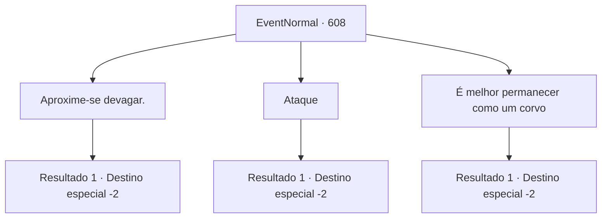

# Eventos normais · 608

[Índice da tabela](index.md) · [Índice geral](../index.md)

ID: `pt:EventNormal:608` · Fonte: `EventNormal4` · Versão: 1.2.47.

Mapeamento estático dos arquivos; a disponibilidade e a execução dependem do estado da run.

## Texto do evento

*Sem texto no arquivo.*

## Dados de entrada

```json
{
  "id": 608,
  "grade": 1,
  "place": "",
  "required": ""
}
```

## Mapa das escolhas



## Escolhas e resultados

### Escolha 1

Aproxime-se devagar.

Requisitos e outros campos da escolha:

```json
{
  "required": ""
}
```

#### Resultado 1.1

Você aconselha o corvo a começar limpando sua casa e gradualmente descobrir o que a pega precisa. O diabinho parece encorajado pela sua sugestão. Com uma expressão determinada, ele acena com a cabeça e diz, 

 "Hmm... tudo bem. Por enquanto..."

 Então, ele se transforma de volta em um corvo e voa embora.

Continuação registrada: [Destino especial `-2`](../destinos-especiais.md).

```json
{
  "required": "",
  "chance": "1",
  "nextEvent": -2,
  "type": 2,
  "reward": "5_767_9"
}
```

### Escolha 2

Ataque

Requisitos e outros campos da escolha:

```json
{
  "required": ""
}
```

#### Resultado 2.1

Você ataca o diabrete imediatamente. Ele rapidamente se transforma de volta em um corvo e recua. 

 "Argh, droga! Viu? Viu? Como eu devo ir e perguntar quando todo mundo só tenta me matar à primeira vista?!"

 Então, ele bate as asas e voa embora.

Continuação registrada: [Destino especial `-2`](../destinos-especiais.md).

```json
{
  "required": "",
  "chance": "1",
  "nextEvent": -2,
  "type": 2,
  "reward": "5_767_9"
}
```

### Escolha 3

É melhor permanecer como um corvo

Requisitos e outros campos da escolha:

```json
{
  "required": ""
}
```

#### Resultado 3.1

Você não nega a pergunta do diabrete e sugere que é melhor permanecer em sua forma de corvo. O diabrete suspira e balança a cabeça. 

 "Eu não posso continuar fazendo isso para sempre... Além disso, alguém como eu—um demônio insignificante—não pode enganá-los por muito tempo."

 Resmungando sobre como isso não ajuda, o diabrete vai embora.

Continuação registrada: [Destino especial `-2`](../destinos-especiais.md).

```json
{
  "required": "",
  "chance": "1",
  "nextEvent": -2,
  "type": 2,
  "reward": ""
}
```

## Referências que chegam a este evento

- [Evento 607 · escolha 2 · resultado 1](0607.md#escolha-2)
