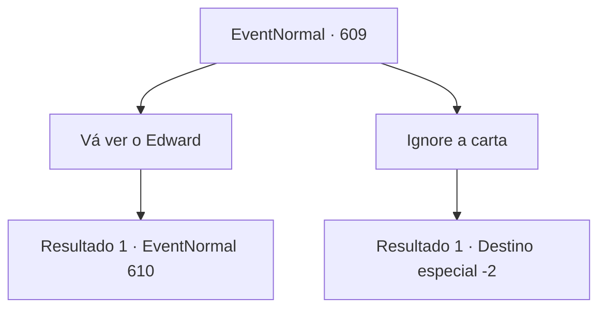

# Eventos normais · 609

[Índice da tabela](index.md) · [Índice geral](../index.md)

ID: `pt:EventNormal:609` · Fonte: `EventNormal4` · Versão: 1.2.47.

Mapeamento estático dos arquivos; a disponibilidade e a execução dependem do estado da run.

## Texto do evento

Um pombo voa ruidosamente em sua direção. Amarrado em seu pescoço está um lenço inscrito com um tridente azul - o símbolo da Casa Ronan. Você estende o braço, para que o pombo possa pousar sobre ele. 

 "Coo coo... coo coo."

 O pombo se acomoda. Cuidadosamente, você desamarra a carta presa em seus pés. A carta é da Condessa Irema.
 'Edward deseja vê-lo novamente. Ele o considera seu modelo - passe por aqui quando tiver tempo. Por favor.'
 Tendo completado sua missão, o pombo abre as asas novamente e alça voo. Você silenciosamente o observa voar para longe no céu.

## Dados de entrada

```json
{
  "id": 609,
  "grade": 2,
  "place": "",
  "required": "5_828_1|1_2_60"
}
```

## Mapa das escolhas



## Escolhas e resultados

### Escolha 1

Vá ver o Edward

Requisitos e outros campos da escolha:

```json
{
  "required": ""
}
```

#### Resultado 1.1

A pedido de Irema, você volta para ver Edward novamente. Ele cresceu - mais saudável e mais alto do que você se lembra. Ele corre até você com os olhos arregalados. Provavelmente não esperava você aqui hoje. 

 "Oh! U- uh... O que você está fazendo aqui?"

 Ele rapidamente acrescenta para esclarecer o que quis dizer. 

 "Eu- eu quero dizer! Estou feliz em ver você! TÃO feliz em ver você, na verdade!"

 Seus olhos estão quase brilhando de empolgação. Irema, observando vocês dois, sorri calorosamente e fala. 

 "Obrigada por vir. Edward sentiu muito a sua falta. Vocês dois gostariam de passar um tempo juntos? Vou preparar pessoalmente uma refeição para vocês hoje."

 Irema vai para a cozinha. Edward te dá um olhar animado. 

 "Na verdade, eu... eu quero que você me ensine algo."


Continuação registrada: [Evento 610](0610.md) na mesma tabela.

```json
{
  "required": "",
  "chance": "1",
  "nextEvent": 610,
  "type": 2,
  "reward": ""
}
```

### Escolha 2

Ignore a carta

Requisitos e outros campos da escolha:

```json
{
  "required": ""
}
```

#### Resultado 2.1

Você ignora a carta de Irema.

Continuação registrada: [Destino especial `-2`](../destinos-especiais.md).

```json
{
  "required": "",
  "chance": "1",
  "nextEvent": -2,
  "type": 2,
  "reward": "5_828_9"
}
```

## Referências que chegam a este evento

Nenhum `nextEvent` positivo da mesma tabela aponta para este nó. Isso não prova que seja inacessível: sorteio e estado de história podem selecioná-lo.

