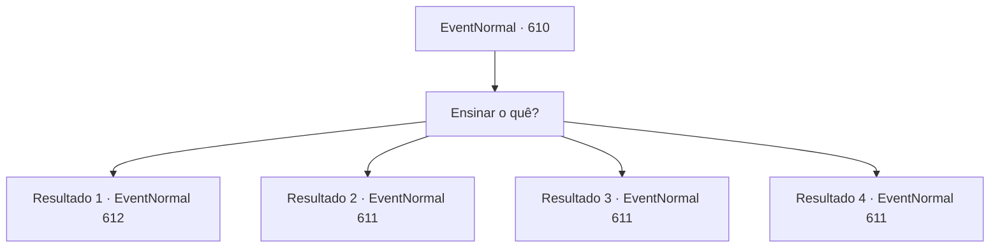

# Eventos normais · 610

[Índice da tabela](index.md) · [Índice geral](../index.md)

ID: `pt:EventNormal:610` · Fonte: `EventNormal4` · Versão: 1.2.47.

Mapeamento estático dos arquivos; a disponibilidade e a execução dependem do estado da run.

## Texto do evento

*Sem texto no arquivo.*

## Dados de entrada

```json
{
  "id": 610,
  "grade": 2,
  "place": "",
  "required": ""
}
```

## Mapa das escolhas



## Escolhas e resultados

### Escolha 1

Ensinar o quê?

Requisitos e outros campos da escolha:

```json
{
  "required": ""
}
```

#### Resultado 1.1

Edward pega uma lança de madeira e volta para você. 

 "Você me mostrou alguns movimentos da última vez. Tenho praticado. Gostaria de uma lição hoje também."

 Desta vez, você pega uma lança para si e participa de um pequeno treino. As habilidades de Edward melhoraram muito, mas ele ainda não é páreo para você. Seus olhos brilham novamente. Ele murmura para si mesmo com admiração. 

 "Simplesmente incrível...!"

 Após o término da sua lição, Irema chama vocês dois. 

 "O jantar está pronto! Venham, venham."


Continuação registrada: [Evento 612](0612.md) na mesma tabela.

```json
{
  "required": "5_827_1",
  "chance": "1",
  "nextEvent": 612,
  "type": 2,
  "reward": ""
}
```

#### Resultado 1.2

Edward quer que você o ensine exatamente como ele deve convencer as pessoas e dividi-las em diferentes facções. 

 "Você me ensinou da última vez a 'desviar a atenção das pessoas'. Acho que poderia fazer muito melhor com alguns detalhes."


Continuação registrada: [Evento 611](0611.md) na mesma tabela.

```json
{
  "required": "5_824_1",
  "chance": "1",
  "nextEvent": 611,
  "type": 2,
  "reward": ""
}
```

#### Resultado 1.3

Edward quer que você o ensine exatamente como ele deve ouvir as pessoas e como ele pode intervir em conflitos para mitigá-los. 

 "Você me ensinou da última vez a 'resolver problemas com sabedoria'. Acho que eu poderia fazer muito melhor com alguns detalhes."


Continuação registrada: [Evento 611](0611.md) na mesma tabela.

```json
{
  "required": "5_825_1",
  "chance": "1",
  "nextEvent": 611,
  "type": 2,
  "reward": ""
}
```

#### Resultado 1.4

Edward quer que você ensine a ele como exatamente ele deve lidar com problemas reais e iminentes. 

 "Você me ensinou da última vez a 'evitar problemas sempre que possível'. Acho que eu poderia me sair muito melhor com alguns detalhes."


Continuação registrada: [Evento 611](0611.md) na mesma tabela.

```json
{
  "required": "5_826_1",
  "chance": "1",
  "nextEvent": 611,
  "type": 2,
  "reward": ""
}
```

## Referências que chegam a este evento

- [Evento 609 · escolha 1 · resultado 1](0609.md#escolha-1)
