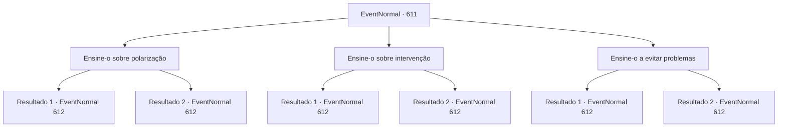

# Eventos normais · 611

[Índice da tabela](index.md) · [Índice geral](../index.md)

ID: `pt:EventNormal:611` · Fonte: `EventNormal4` · Versão: 1.2.47.

Mapeamento estático dos arquivos; a disponibilidade e a execução dependem do estado da run.

## Texto do evento

*Sem texto no arquivo.*

## Dados de entrada

```json
{
  "id": 611,
  "grade": 2,
  "place": "",
  "required": ""
}
```

## Mapa das escolhas



## Escolhas e resultados

### Escolha 1

Ensine-o sobre polarização

Requisitos e outros campos da escolha:

```json
{
  "required": "5_824_1"
}
```

#### Resultado 1.1

Você o ensina sobre polarização - a arte de classificar a multidão em diferentes categorias e fazê-las lutar entre si. Sua cidade natal, idade, religião... Qualquer característica tem o potencial de ser a semente da disputa. Manipule-os sabiamente, e semear a discórdia em uma multidão não poderia ser mais fácil. E quando eles estão ocupados lutando entre si, eles teriam, em última análise, menos tempo para se preocupar com seus líderes. Edward absorve seus ensinamentos como uma esponja. Seus olhos brilham de admiração enquanto ele resume o que aprendeu. 

 "Entendo...! Claro que eles estariam ocupados demais lutando entre si para se preocuparem comigo! Obrigado!"

 Então, Irema chama vocês dois. 

 "O jantar está pronto! Venham, venham."


Continuação registrada: [Evento 612](0612.md) na mesma tabela.

```json
{
  "required": "",
  "chance": "1|0_12_1",
  "nextEvent": 612,
  "type": 0,
  "reward": ""
}
```

#### Resultado 1.2

Você o ensina sobre polarização - a arte de classificar a multidão em diferentes categorias e fazê-las lutar entre si. Sua lição foi longa demais, chata ou difícil - ou todas as três -, porque Edward parece não ter ideia do que fazer com isso. 

 "Eu... Eu vejo que tenho muito a aprender. Bem, obrigado pelo conselho de qualquer forma."

 Então, Irema chama vocês dois. 

 "O jantar está pronto! Venham, venham."


Continuação registrada: [Evento 612](0612.md) na mesma tabela.

```json
{
  "required": "",
  "chance": "16",
  "nextEvent": 612,
  "type": 1,
  "reward": ""
}
```

### Escolha 2

Ensine-o sobre intervenção

Requisitos e outros campos da escolha:

```json
{
  "required": "5_825_1"
}
```

#### Resultado 2.1

Você o ensina sobre intervenção - a arte de ouvir ativamente a voz do povo e encontrar soluções sábias e pacíficas para problemas que aparentemente não têm resposta. Edward parece profundamente impressionado com seus ensinamentos sábios. Seus olhos brilham de admiração enquanto ele resume o que aprendeu. 

 "Entendi...! Preciso ouvir várias opiniões e fazer as intervenções necessárias... Obrigado. Agora eu entendo."

 Então, Irema chama vocês dois. 

 "O jantar está pronto! Venham, venham."


Continuação registrada: [Evento 612](0612.md) na mesma tabela.

```json
{
  "required": "",
  "chance": "1|0_14_1",
  "nextEvent": 612,
  "type": 0,
  "reward": ""
}
```

#### Resultado 2.2

Você o ensina sobre intervenção - a arte de ouvir ativamente a voz do povo e encontrar soluções sábias e pacíficas para problemas que aparentemente não têm resposta. Sua lição foi longa demais, chata ou difícil - ou todas as três -, porque Edward parece não ter ideia do que fazer com isso. 

 "Eu... Eu vejo que tenho muito a aprender. Bem, obrigado pelo conselho de qualquer forma."

 Então, Irema chama vocês dois. 

 "O jantar está pronto! Venham, venham."

 Você se delicia com uma refeição preparada pela própria Condessa. Depois de passar a noite em um quarto luxuoso, você retorna às suas aventuras.

Continuação registrada: [Evento 612](0612.md) na mesma tabela.

```json
{
  "required": "",
  "chance": "16",
  "nextEvent": 612,
  "type": 1,
  "reward": ""
}
```

### Escolha 3

Ensine-o a evitar problemas

Requisitos e outros campos da escolha:

```json
{
  "required": "5_826_1"
}
```

#### Resultado 3.1

Você o ensina sobre maneiras de evitar problemas. Você conta a ele a anedota do coelho. Assim como um coelho prepara três tocas, você aconselha Edward a preparar lugares para onde ele possa fugir, caso a multidão furiosa venha atrás dele. Edward acena com a cabeça, com um olhar confiante no rosto. 

 "Entendo... Obrigado."

 Irema acalma Edward e se volta para você. 

 "Você deveria passar de vez em quando, contar a Edward algumas de suas aventuras. O jantar deve estar pronto agora."

 Você e Edward a seguem até o refeitório.

Continuação registrada: [Evento 612](0612.md) na mesma tabela.

```json
{
  "required": "",
  "chance": "1|0_7_1",
  "nextEvent": 612,
  "type": 0,
  "reward": ""
}
```

#### Resultado 3.2

Você o ensina sobre maneiras de evitar problemas. Sua lição foi longa demais, chata ou difícil - ou todas as três -, porque Edward parece não ter ideia do que fazer com isso. 

 "Eu... Eu vejo que tenho muito a aprender. Bem, obrigado pelo conselho de qualquer forma."

 Então, Irema chama vocês dois. 

 "O jantar está pronto! Venham, venham."

 Você se delicia com uma refeição preparada pela própria Condessa. Depois de passar a noite em um quarto luxuoso, você retorna às suas aventuras.

Continuação registrada: [Evento 612](0612.md) na mesma tabela.

```json
{
  "required": "",
  "chance": "16",
  "nextEvent": 612,
  "type": 1,
  "reward": ""
}
```

## Referências que chegam a este evento

- [Evento 610 · escolha 1 · resultado 2](0610.md#escolha-1)
- [Evento 610 · escolha 1 · resultado 3](0610.md#escolha-1)
- [Evento 610 · escolha 1 · resultado 4](0610.md#escolha-1)
