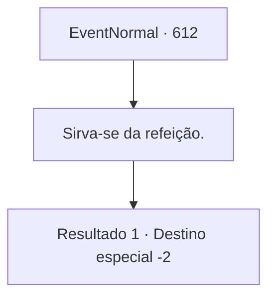

# Eventos normais · 612

[Índice da tabela](index.md) · [Índice geral](../index.md)

ID: `pt:EventNormal:612` · Fonte: `EventNormal4` · Versão: 1.2.47.

Mapeamento estático dos arquivos; a disponibilidade e a execução dependem do estado da run.

## Texto do evento

*Sem texto no arquivo.*

## Dados de entrada

```json
{
  "id": 612,
  "grade": 2,
  "place": "",
  "required": ""
}
```

## Mapa das escolhas



## Escolhas e resultados

### Escolha 1

Sirva-se da refeição.

Requisitos e outros campos da escolha:

```json
{
  "required": ""
}
```

#### Resultado 1.1

Você se presenteia com uma refeição preparada pela própria Condessa. Você passa a noite em um confortável e luxuoso quarto de hóspedes. No dia seguinte, Irema o acompanha para fora dos terrenos do castelo, entregando-lhe uma pequena bolsa. 

 "O Conde está em uma missão no exterior. Devo pedir seu perdão por não tratá-lo bem o suficiente. Você deve aceitar isto - é o mínimo que posso fazer por você."

 Dentro da bolsa, você encontra um pouco de ouro e uma poção. Você a agradece pelo presente e se despede.

Continuação registrada: [Destino especial `-2`](../destinos-especiais.md).

```json
{
  "required": "",
  "chance": "1",
  "nextEvent": -2,
  "type": 2,
  "reward": "5_828_9|0_4_50|3_36_1|3_37_1"
}
```

## Referências que chegam a este evento

- [Evento 610 · escolha 1 · resultado 1](0610.md#escolha-1)
- [Evento 611 · escolha 1 · resultado 1](0611.md#escolha-1)
- [Evento 611 · escolha 1 · resultado 2](0611.md#escolha-1)
- [Evento 611 · escolha 2 · resultado 1](0611.md#escolha-2)
- [Evento 611 · escolha 2 · resultado 2](0611.md#escolha-2)
- [Evento 611 · escolha 3 · resultado 1](0611.md#escolha-3)
- [Evento 611 · escolha 3 · resultado 2](0611.md#escolha-3)
