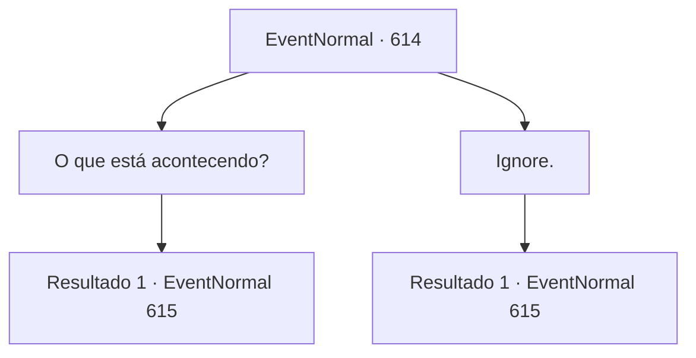

# Eventos normais · 614

[Índice da tabela](index.md) · [Índice geral](../index.md)

ID: `pt:EventNormal:614` · Fonte: `EventNormal4` · Versão: 1.2.47.

Mapeamento estático dos arquivos; a disponibilidade e a execução dependem do estado da run.

## Texto do evento

É uma noite em que até o luar perdeu sua cor. Você encontra um aventureiro sentado atordoado à beira da estrada. Com olhos vazios fixos no céu, ele murmura. 

 "A morte... a morte está... chegando..."


## Dados de entrada

```json
{
  "id": 614,
  "grade": 4,
  "place": "",
  "required": "35_0_0|5_829_0|5_844_1"
}
```

## Mapa das escolhas



## Escolhas e resultados

### Escolha 1

O que está acontecendo?

Requisitos e outros campos da escolha:

```json
{
  "required": ""
}
```

#### Resultado 1.1

Ele não mostra reação à sua pergunta. Logo depois, um frio arrepiante enche o ar. Quando você se vira, vê algo em um cavalo pálido emergindo através de uma fenda de vazio negro como breu. |drawing_paleHorseman| Um manto cinza esvoaça sobre sua armadura pálida, e onde quer que os cascos pálidos toquem o chão, a grama murcha e fica preta. Não há rosto sob seu elmo—apenas uma névoa pálida sai de dentro. O cavaleiro levanta uma foice curva como uma lua crescente. 

 "P‑por favor… poupe-me…"

 O aventureiro ajoelhado diante dele treme e implora por misericórdia, mas com um único golpe da foice, até sua voz é cortada. Nenhum sangue é derramado, mas seu corpo desaba como uma vela apagada. Agora, o olhar do cavaleiro se volta para você.

Continuação registrada: [Evento 615](0615.md) na mesma tabela.

```json
{
  "required": "",
  "chance": "1",
  "nextEvent": 615,
  "type": 2,
  "reward": "5_829_1"
}
```

### Escolha 2

Ignore.

Requisitos e outros campos da escolha:

```json
{
  "required": ""
}
```

#### Resultado 2.1

Você tenta ignorá-lo e seguir em frente. No entanto, um frio arrepiante logo se segue quando algo em um cavalo pálido emerge de uma fenda no vazio negro como breu. |drawing_paleHorseman| Uma capa cinza esvoaça sobre sua armadura pálida, e onde quer que os cascos pálidos toquem o chão, a grama murcha e fica preta. Não há rosto sob seu elmo—apenas uma névoa pálida sai de dentro. O cavaleiro levanta uma foice curva como uma lua crescente. 

 "P-por favor... poupe-me..."

 O aventureiro ajoelhado diante dele treme e implora por misericórdia, mas com um único golpe da foice, até sua voz é cortada. Nenhum sangue é derramado, mas seu corpo desaba como uma vela apagada. Agora, o olhar do cavaleiro se volta para você.

Continuação registrada: [Evento 615](0615.md) na mesma tabela.

```json
{
  "required": "",
  "chance": "1",
  "nextEvent": 615,
  "type": 2,
  "reward": "5_829_1"
}
```

## Referências que chegam a este evento

Nenhum `nextEvent` positivo da mesma tabela aponta para este nó. Isso não prova que seja inacessível: sorteio e estado de história podem selecioná-lo.

