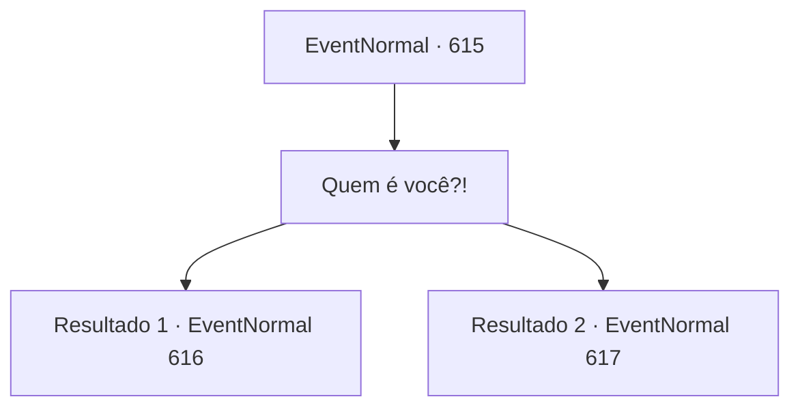

# Eventos normais · 615

[Índice da tabela](index.md) · [Índice geral](../index.md)

ID: `pt:EventNormal:615` · Fonte: `EventNormal4` · Versão: 1.2.47.

Mapeamento estático dos arquivos; a disponibilidade e a execução dependem do estado da run.

## Texto do evento

*Sem texto no arquivo.*

## Dados de entrada

```json
{
  "id": 615,
  "grade": 1,
  "place": "",
  "required": ""
}
```

## Mapa das escolhas



## Escolhas e resultados

### Escolha 1

Quem é você?!

Requisitos e outros campos da escolha:

```json
{
  "required": ""
}
```

#### Resultado 1.1

Em resposta à sua pergunta, ele fala com uma voz como centenas de almas lamentando em uníssono. <i><link=shake>

 "Eu sou o arauto da morte."

</link></i> À medida que suas palavras chegam até você, um frio percorre seu corpo e arrepios surgem em sua pele. Sinos de alarme tocam em sua mente, alertando sobre uma ameaça instintiva. Mesmo assim, você consegue permanecer o mais calmo possível.

Continuação registrada: [Evento 616](0616.md) na mesma tabela.

```json
{
  "required": "",
  "chance": "1|0_14_1",
  "nextEvent": 616,
  "type": 0,
  "reward": ""
}
```

#### Resultado 1.2

Em resposta à sua pergunta, ele fala com uma voz que soa como centenas de almas lamentando. <i><link=shake>

 "Eu sou o arauto da morte."

</link></i> Ao ouvir sua voz, você sente um frio percorrer seu corpo e fica arrepiado. Em sua mente, um alarme instintivo soa, sinalizando uma ameaça. Ele avança e investe com um cavalo pálido. Então, balança uma foice gigante para atacá-lo. Você treme de medo ao enfrentar seu ataque.

Continuação registrada: [Evento 617](0617.md) na mesma tabela.

```json
{
  "required": "",
  "chance": "20",
  "nextEvent": 617,
  "type": 1,
  "reward": "6_0_188",
  "place": 13
}
```

## Referências que chegam a este evento

- [Evento 614 · escolha 1 · resultado 1](0614.md#escolha-1)
- [Evento 614 · escolha 2 · resultado 1](0614.md#escolha-2)
