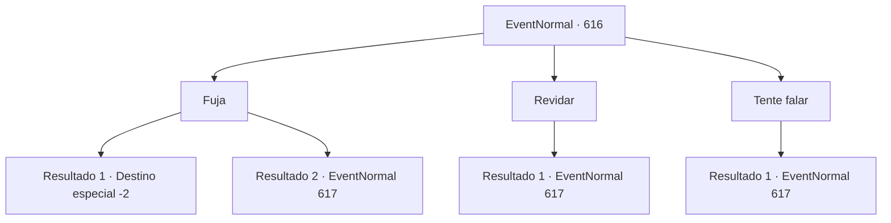

# Eventos normais · 616

[Índice da tabela](index.md) · [Índice geral](../index.md)

ID: `pt:EventNormal:616` · Fonte: `EventNormal4` · Versão: 1.2.47.

Mapeamento estático dos arquivos; a disponibilidade e a execução dependem do estado da run.

## Texto do evento

*Sem texto no arquivo.*

## Dados de entrada

```json
{
  "id": 616,
  "grade": 1,
  "place": "",
  "required": ""
}
```

## Mapa das escolhas



## Escolhas e resultados

### Escolha 1

Fuja

Requisitos e outros campos da escolha:

```json
{
  "required": ""
}
```

#### Resultado 1.1

O arauto da morte está te perseguindo, mas você mal consegue escapar da perseguição. <i><link=shake>

 "Você não pode me evitar para sempre, mortal..."

</link></i> Quando o amanhecer chega, ele corta o ar com uma foice para criar uma fenda dimensional e desaparece na brecha negra como breu. Só então você sente o calor do mundo dos vivos.

Continuação registrada: [Destino especial `-2`](../destinos-especiais.md).

```json
{
  "required": "",
  "chance": "1|0_6_1",
  "nextEvent": -2,
  "type": 0,
  "reward": "22_107_1|5_831_1"
}
```

#### Resultado 1.2

Você tenta escapar do arauto da morte. No entanto, a velocidade do cavalo pálido é muito maior do que seus passos. O cavaleiro rapidamente bloqueia seu caminho e balança uma foice gigante para atacá-lo.

Continuação registrada: [Evento 617](0617.md) na mesma tabela.

```json
{
  "required": "",
  "chance": "30",
  "nextEvent": 617,
  "type": 1,
  "reward": "6_0_188",
  "place": 13
}
```

### Escolha 2

Revidar

Requisitos e outros campos da escolha:

```json
{
  "required": ""
}
```

#### Resultado 2.1

Você decide confrontar o arauto da morte e se preparar para a batalha. Então, uma luz azul pisca do capacete, e uma voz que soa como centenas de almas lamentando diz. <i><link=shake>

 "Tolo. Enfrentar a morte."

</link></i> Ele avança e investe com um cavalo pálido, então balança uma foice gigante para atacá-lo.

Continuação registrada: [Evento 617](0617.md) na mesma tabela.

```json
{
  "required": "",
  "chance": "1",
  "nextEvent": 617,
  "type": 2,
  "reward": "6_0_188|5_832_1",
  "place": 13
}
```

### Escolha 3

Tente falar

Requisitos e outros campos da escolha:

```json
{
  "required": ""
}
```

#### Resultado 3.1

Você tenta falar com o arauto da morte. No entanto, ele avança e investe com um cavalo pálido. Em seguida, balança uma foice gigante e ataca você.

Continuação registrada: [Evento 617](0617.md) na mesma tabela.

```json
{
  "required": "",
  "chance": "1",
  "nextEvent": 617,
  "type": 2,
  "reward": "6_0_188",
  "place": 13
}
```

## Referências que chegam a este evento

- [Evento 615 · escolha 1 · resultado 1](0615.md#escolha-1)
