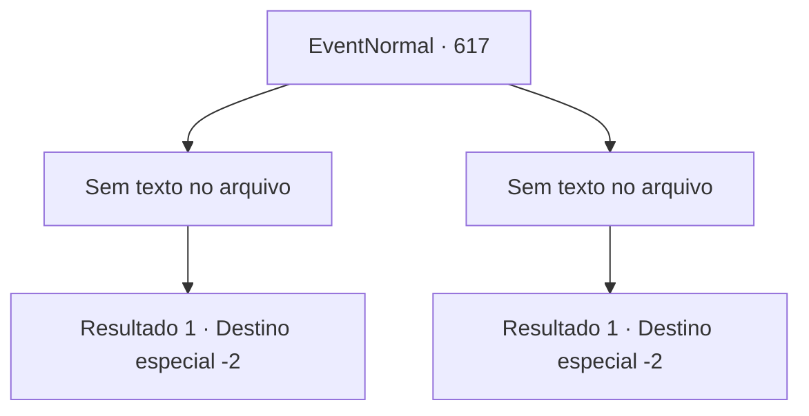

# Eventos normais · 617

[Índice da tabela](index.md) · [Índice geral](../index.md)

ID: `pt:EventNormal:617` · Fonte: `EventNormal4` · Versão: 1.2.47.

Mapeamento estático dos arquivos; a disponibilidade e a execução dependem do estado da run.

## Texto do evento

*Sem texto no arquivo.*

## Dados de entrada

```json
{
  "id": 617,
  "grade": 1,
  "place": "",
  "required": ""
}
```

## Mapa das escolhas



## Escolhas e resultados

### Escolha 1

*Sem texto no arquivo; o papel dessa opção depende da interface do jogo.*

Requisitos e outros campos da escolha:

```json
{
  "required": ""
}
```

#### Resultado 1.1

Você derrota a personificação da morte. Ela desmorona, depois se levanta novamente e diz. <i><link=shake>

 "Você não pode me evitar para sempre, mortal..."

</link></i> Em seguida, corta o ar com uma foice, criando uma fenda dimensional, e desaparece na brecha negra como breu. Só então você pode sentir o calor do mundo dos vivos.

Continuação registrada: [Destino especial `-2`](../destinos-especiais.md).

```json
{
  "required": "",
  "chance": "1",
  "nextEvent": -2,
  "type": 2,
  "reward": "22_107_1|5_833_1"
}
```

### Escolha 2

*Sem texto no arquivo; o papel dessa opção depende da interface do jogo.*

Requisitos e outros campos da escolha:

```json
{
  "required": ""
}
```

#### Resultado 2.1

Você desafia o arauto da morte, mas não é páreo para ele. Ele balança sua foice em você enquanto você cai. Um frio que perfura seus ossos é sentido, e sua alma é cortada. <i><link=shake>

 "Ha.. haha..."

</link></i> Com uma risada seca, o cavaleiro engole um fragmento de sua alma. Então, ele corta o ar com sua foice para criar uma fenda dimensional e desaparece na brecha negra como breu. Só então você sente o calor do mundo dos vivos.

Continuação registrada: [Destino especial `-2`](../destinos-especiais.md).

```json
{
  "required": "",
  "chance": "1",
  "nextEvent": -2,
  "type": 2,
  "reward": "0_0_-1|0_1_-1"
}
```

## Referências que chegam a este evento

- [Evento 615 · escolha 1 · resultado 2](0615.md#escolha-1)
- [Evento 616 · escolha 1 · resultado 2](0616.md#escolha-1)
- [Evento 616 · escolha 2 · resultado 1](0616.md#escolha-2)
- [Evento 616 · escolha 3 · resultado 1](0616.md#escolha-3)
