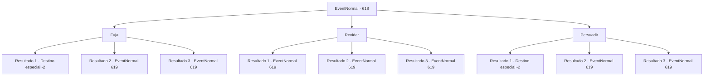

# Eventos normais · 618

[Índice da tabela](index.md) · [Índice geral](../index.md)

ID: `pt:EventNormal:618` · Fonte: `EventNormal4` · Versão: 1.2.47.

Mapeamento estático dos arquivos; a disponibilidade e a execução dependem do estado da run.

## Texto do evento

Após as nuvens apagarem até a luz da lua, você sente o olhar de alguém vindo de dentro da escuridão. Sinos de alarme soam em sua mente, alertando sobre uma ameaça instintiva. Você imediatamente percebe que o Avatar da Morte chegou. |drawing_paleHorseman|

## Dados de entrada

```json
{
  "id": 618,
  "grade": 4,
  "place": "",
  "required": "35_0_0|5_829_1|21_107_3"
}
```

## Mapa das escolhas



## Escolhas e resultados

### Escolha 1

Fuja

Requisitos e outros campos da escolha:

```json
{
  "required": ""
}
```

#### Resultado 1.1

O arauto da morte montado no cavalo pálido está te perseguindo, mas você está fugindo dele o mais rápido que pode. Ele te segue com uma risada gelada. <i><link=shake>

 "Interessante sujeito. Vou observar para ver quanto tempo você consegue fugir."

</link></i> Quando o amanhecer chega, ele corta o ar com uma foice para criar uma fenda na dimensão e desaparece na brecha negra como breu. Só então você pode sentir o calor do mundo dos vivos.

Continuação registrada: [Destino especial `-2`](../destinos-especiais.md).

```json
{
  "required": "",
  "chance": "1|0_6_1",
  "nextEvent": -2,
  "type": 0,
  "reward": "22_107_1"
}
```

#### Resultado 1.2

Você tenta escapar do arauto da morte. No entanto, a velocidade do cavalo pálido é muito maior do que seus passos. O cavaleiro rapidamente bloqueia seu caminho e balança uma foice gigante para atacá-lo.

Continuação registrada: [Evento 619](0619.md) na mesma tabela.

```json
{
  "required": "18_831_1",
  "chance": "30",
  "nextEvent": 619,
  "type": 1,
  "reward": "6_0_188",
  "place": 13
}
```

#### Resultado 1.3

Você tenta escapar do arauto da morte. No entanto, ele se lembra de que você já havia escapado antes, e no momento em que você se vira, ele salta sobre você e bloqueia seu caminho. <i><link=shake>

 "Você não escapará mais."

</link></i>

Continuação registrada: [Evento 619](0619.md) na mesma tabela.

```json
{
  "required": "5_831_1",
  "chance": "60",
  "nextEvent": 619,
  "type": 1,
  "reward": "6_0_188",
  "place": 13
}
```

### Escolha 2

Revidar

Requisitos e outros campos da escolha:

```json
{
  "required": ""
}
```

#### Resultado 2.1

Você decide confrontar a personificação da morte e se preparar para a batalha. Então, uma luz azul pisca, e uma voz que soa como centenas de almas lamentando diz. <i><link=shake>

 "Tolo. Enfrentar a morte."

</link></i> Ele avança e investe com um cavalo pálido. Em seguida, balança uma foice gigante para atacá-lo.

Continuação registrada: [Evento 619](0619.md) na mesma tabela.

```json
{
  "required": "18_832_1",
  "chance": "1",
  "nextEvent": 619,
  "type": 2,
  "reward": "6_0_188",
  "place": 13
}
```

#### Resultado 2.2

Você decide confrontar o arauto da morte e se preparar para a batalha. Ele então pisca seus olhos azuis e aponta sua foice. Ele rosna, exalando uma aura gelada e assustadora. <i><link=shake>

 "Mortal arrogante... não ouse me desafiar."

</link></i> Ele avança e investe com um cavalo pálido. Então ele balança sua foice gigante para atacá-lo.

Continuação registrada: [Evento 619](0619.md) na mesma tabela.

```json
{
  "required": "5_833_1",
  "chance": "1",
  "nextEvent": 619,
  "type": 2,
  "reward": "6_0_188",
  "place": 13
}
```

#### Resultado 2.3

Você decide confrontar o arauto da morte e se preparar para a batalha. O arauto da morte então pisca os olhos e aponta sua foice. Ele solta uma risada gelada. <i><link=shake>

 "Vou te lembrar da lição da última vez..."

</link></i> Ele avança e investe com um cavalo pálido. Então ele balança sua foice gigante para te atacar.

Continuação registrada: [Evento 619](0619.md) na mesma tabela.

```json
{
  "required": "18_833_1",
  "chance": "1",
  "nextEvent": 619,
  "type": 2,
  "reward": "6_0_188",
  "place": 13
}
```

### Escolha 3

Persuadir

Requisitos e outros campos da escolha:

```json
{
  "required": ""
}
```

#### Resultado 3.1

Você tenta persuadir logicamente o arauto da morte. Ao lembrá-lo de sua derrota anterior, o arauto da morte lentamente dá um passo para trás e diz. <i><link=shake>

 "...Você também logo ficará velho e doente. Não há necessidade de ser precipitado."

</link></i> Então ele vira seu cavalo e segue para outro lugar.

Continuação registrada: [Destino especial `-2`](../destinos-especiais.md).

```json
{
  "required": "5_833_1",
  "chance": "1|0_12_1",
  "nextEvent": -2,
  "type": 0,
  "reward": "22_107_1"
}
```

#### Resultado 3.2

Você tenta persuadir, mas ele apenas responde em um tom seco. <i><link=shake>

 "... Você sabe quantas pessoas falam na minha frente?"

</link></i> Ele ri com um som de ossos chacoalhando, então avança e investe com um cavalo pálido. E balança uma foice gigante para atacá-lo.

Continuação registrada: [Evento 619](0619.md) na mesma tabela.

```json
{
  "required": "5_833_1",
  "chance": "50",
  "nextEvent": 619,
  "type": 1,
  "reward": "6_0_188",
  "place": 13
}
```

#### Resultado 3.3

Você tenta persuadir, mas ele apenas responde em um tom seco. <i><link=shake>

 "... Você sabe quantos já balançaram suas línguas diante de mim?"

</link></i> Ele ri com um som de ossos chacoalhando, então avança e investe com um cavalo pálido. E balança uma foice gigante para atacá-lo.

Continuação registrada: [Evento 619](0619.md) na mesma tabela.

```json
{
  "required": "18_833_1",
  "chance": "1",
  "nextEvent": 619,
  "type": 2,
  "reward": "6_0_188",
  "place": 13
}
```

## Referências que chegam a este evento

Nenhum `nextEvent` positivo da mesma tabela aponta para este nó. Isso não prova que seja inacessível: sorteio e estado de história podem selecioná-lo.

