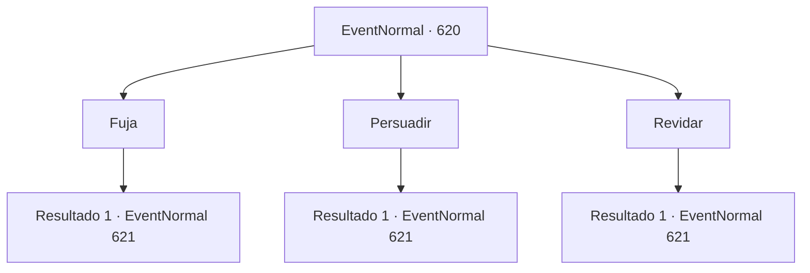

# Eventos normais · 620

[Índice da tabela](index.md) · [Índice geral](../index.md)

ID: `pt:EventNormal:620` · Fonte: `EventNormal4` · Versão: 1.2.47.

Mapeamento estático dos arquivos; a disponibilidade e a execução dependem do estado da run.

## Texto do evento

Em uma noite em que tudo está tingido de cinza-acinzentado, um frio percorre seu corpo, levantando arrepios. Sinos de alarme soam em sua mente, alertando sobre uma ameaça primordial. Você percebe que o Avatar da Morte apareceu mais uma vez. |drawing_paleHorseman|

## Dados de entrada

```json
{
  "id": 620,
  "grade": 4,
  "place": "",
  "required": "35_0_0|20_107_3|5_829_1"
}
```

## Mapa das escolhas



## Escolhas e resultados

### Escolha 1

Fuja

Requisitos e outros campos da escolha:

```json
{
  "required": ""
}
```

#### Resultado 1.1

Você tenta escapar do arauto da morte. No entanto, parece que ele já previu sua fuga. O cavalo pálido salta sobre você e bloqueia seu caminho. Então o cavaleiro balança uma foice gigante e ataca você.

Continuação registrada: [Evento 621](0621.md) na mesma tabela.

```json
{
  "required": "",
  "chance": "1",
  "nextEvent": 621,
  "type": 2,
  "reward": "6_3_188",
  "place": 13
}
```

### Escolha 2

Persuadir

Requisitos e outros campos da escolha:

```json
{
  "required": ""
}
```

#### Resultado 2.1

Você tenta persuadir, mas ele balança a cabeça e diz. <i><link=shake>

 "Não. Conversa é desnecessária."

</link></i> Ele ri com um chocalhar de ossos, então incita e avança com um cavalo pálido. E balança uma foice gigante para atacá-lo.

Continuação registrada: [Evento 621](0621.md) na mesma tabela.

```json
{
  "required": "",
  "chance": "1",
  "nextEvent": 621,
  "type": 2,
  "reward": "6_3_188",
  "place": 13
}
```

### Escolha 3

Revidar

Requisitos e outros campos da escolha:

```json
{
  "required": ""
}
```

#### Resultado 3.1

Você decide confrontar a personificação da morte e se preparar para a batalha. Então, uma luz azul pisca, e uma voz que soa como centenas de almas lamentando diz. <i><link=shake>

 "Hahaha! Bom..."

</link></i> Ele avança e investe com um cavalo pálido. Em seguida, balança uma foice gigante para atacá-lo.

Continuação registrada: [Evento 621](0621.md) na mesma tabela.

```json
{
  "required": "",
  "chance": "1",
  "nextEvent": 621,
  "type": 2,
  "reward": "6_3_188",
  "place": 13
}
```

## Referências que chegam a este evento

Nenhum `nextEvent` positivo da mesma tabela aponta para este nó. Isso não prova que seja inacessível: sorteio e estado de história podem selecioná-lo.

