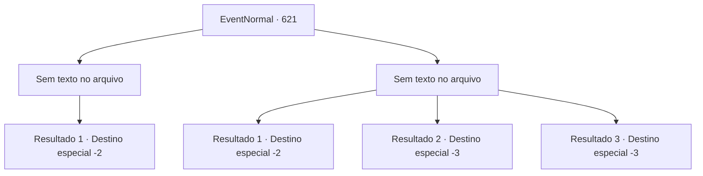

# Eventos normais · 621

[Índice da tabela](index.md) · [Índice geral](../index.md)

ID: `pt:EventNormal:621` · Fonte: `EventNormal4` · Versão: 1.2.47.

Mapeamento estático dos arquivos; a disponibilidade e a execução dependem do estado da run.

## Texto do evento

*Sem texto no arquivo.*

## Dados de entrada

```json
{
  "id": 621,
  "grade": 1,
  "place": "",
  "required": ""
}
```

## Mapa das escolhas



## Escolhas e resultados

### Escolha 1

*Sem texto no arquivo; o papel dessa opção depende da interface do jogo.*

Requisitos e outros campos da escolha:

```json
{
  "required": ""
}
```

#### Resultado 1.1

Você derrota a personificação da morte. Ela cambaleia e murmura em descrença. <i><link=shake>

 "Como... isso é possível..."

</link></i> Então, como uma fogueira morrendo, ela afunda na escuridão. Quando desaparece, uma brisa quente sopra em sua direção.

Continuação registrada: [Destino especial `-2`](../destinos-especiais.md).

```json
{
  "required": "",
  "chance": "1",
  "nextEvent": -2,
  "type": 2,
  "reward": "22_107_1|22_112_-1|5_829_9"
}
```

### Escolha 2

*Sem texto no arquivo; o papel dessa opção depende da interface do jogo.*

Requisitos e outros campos da escolha:

```json
{
  "required": ""
}
```

#### Resultado 2.1

Você desafia o arauto da morte, mas não é páreo para ele. Ele balança sua foice em você enquanto você cai. Um frio que perfura seus ossos é sentido, e sua alma é cortada. <i><link=shake>

 "Ha.. haha..."

</link></i> Com uma risada seca, o cavaleiro engole um fragmento de sua alma. Então, ele corta o ar com sua foice para criar uma fenda dimensional e desaparece na brecha negra como breu. Só então você sente o calor do mundo dos vivos.

Continuação registrada: [Destino especial `-2`](../destinos-especiais.md).

```json
{
  "required": "1_0_2|1_1_2",
  "chance": "1",
  "nextEvent": -2,
  "type": 2,
  "reward": "0_0_-1|0_1_-1"
}
```

#### Resultado 2.2

Toda vez que você é cortado pela foice gigante, em vez de sangue fluir, sua alma é cortada. Seu corpo gradualmente endurece e sai de controle, e eventualmente, seu corpo desaba no chão. Imediatamente depois, uma corrente translúcida se estende do Ceifador e se liga à sua alma. Ela chocalha e solta uma risada satisfeita. <i><link=shake>

 "Hehe... Vamos. Siga-me."

</link></i> A foice gigante balança, criando uma fenda na dimensão. Então, ela leva sua alma para dentro da fenda negra como breu. Sua alma a segue, cruzando um rio do qual nunca poderá retornar.

Continuação registrada: [Destino especial `-3`](../destinos-especiais.md).

```json
{
  "required": "2_0_2",
  "chance": "1",
  "nextEvent": -3,
  "type": 2,
  "reward": "0_0_-1|0_1_-1"
}
```

#### Resultado 2.3

Toda vez que você é cortado pela foice gigante, em vez de sangue fluir, sua alma é cortada. Seu corpo gradualmente endurece e sai de controle, e eventualmente, seu corpo desaba no chão. Imediatamente depois, uma corrente translúcida se estende do Ceifador e se liga à sua alma. Ela chocalha e solta uma risada satisfeita. <i><link=shake>

 "Hehe... Vamos. Siga-me."

</link></i> A foice gigante balança, criando uma fenda na dimensão. Então, ela leva sua alma para dentro da fenda negra como breu. Sua alma a segue, cruzando um rio do qual nunca poderá retornar.

Continuação registrada: [Destino especial `-3`](../destinos-especiais.md).

```json
{
  "required": "2_1_2",
  "chance": "1",
  "nextEvent": -3,
  "type": 2,
  "reward": "0_0_-1|0_1_-1"
}
```

## Referências que chegam a este evento

- [Evento 620 · escolha 1 · resultado 1](0620.md#escolha-1)
- [Evento 620 · escolha 2 · resultado 1](0620.md#escolha-2)
- [Evento 620 · escolha 3 · resultado 1](0620.md#escolha-3)
