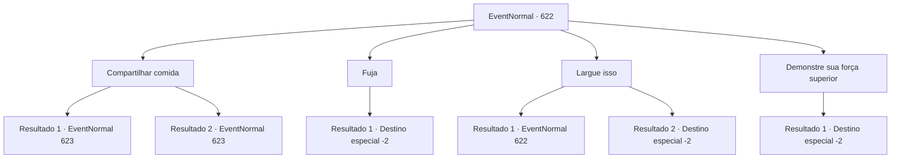

# Eventos normais · 622

[Índice da tabela](index.md) · [Índice geral](../index.md)

ID: `pt:EventNormal:622` · Fonte: `EventNormal4` · Versão: 1.2.47.

Mapeamento estático dos arquivos; a disponibilidade e a execução dependem do estado da run.

## Texto do evento

Ao atravessar uma planície ressecada e rachada, você chega a uma pequena aldeia — mas dificilmente pode ser chamada de aldeia agora. Cadáveres emaciados estão espalhados pelas ruas, toldos esfarrapados balançam sobre edifícios cujas paredes estão fissuradas, o poço secou, não oferecendo uma única gota para beber. Você caminha por uma estrada que antes fervilhava de vida. De repente, a porta de uma cabana dilapidada range ao abrir, e uma garota magra sai. 

 "C‑comida... me dê comida... agora...!"

 Você olha para ela. Faminta por sabe-se lá quanto tempo, ela é pouco mais que pele e osso, e o braço que segura sua adaga treme incontrolavelmente.

## Dados de entrada

```json
{
  "id": 622,
  "grade": 1,
  "place": "",
  "required": "5_843_1|5_837_0"
}
```

## Mapa das escolhas



## Escolhas e resultados

### Escolha 1

Compartilhar comida

Requisitos e outros campos da escolha:

```json
{
  "required": "-1|23_0_1|23_10_1"
}
```

#### Resultado 1.1

Você compartilha comida e bebida com a garota. A garota joga fora a adaga e devora a comida à sua frente vorazmente. No entanto, mesmo depois de comer todas as provisões preparadas, ela ainda parece faminta. A garota olha para você com um olhar de desejo e abre a boca. 

 "Mais, mais... não tem mais...?"


Continuação registrada: [Evento 623](0623.md) na mesma tabela.

```json
{
  "required": "23_0_1",
  "chance": "1",
  "nextEvent": 623,
  "type": 2,
  "reward": "25_0_1"
}
```

#### Resultado 1.2

Você compartilha comida e bebida com a garota. A garota joga fora a adaga e devora a comida à sua frente vorazmente. No entanto, mesmo depois de comer todas as provisões preparadas, ela ainda parece faminta. A garota olha para você com um olhar de desejo e abre a boca. 

 "Mais, mais... não tem mais...?"


Continuação registrada: [Evento 623](0623.md) na mesma tabela.

```json
{
  "required": "23_10_1",
  "chance": "1",
  "nextEvent": 623,
  "type": 2,
  "reward": "25_10_1"
}
```

### Escolha 2

Fuja

Requisitos e outros campos da escolha:

```json
{
  "required": ""
}
```

#### Resultado 2.1

Você vira as costas e foge da garota que te ameaça com uma adaga. Ela não pode te perseguir e desaba no local.

Continuação registrada: [Destino especial `-2`](../destinos-especiais.md).

```json
{
  "required": "",
  "chance": "1",
  "nextEvent": -2,
  "type": 2,
  "reward": ""
}
```

### Escolha 3

Largue isso

Requisitos e outros campos da escolha:

```json
{
  "required": "5_838_0"
}
```

#### Resultado 3.1

Você diz à garota para largar a adaga. Então ela hesita por um momento, solta a adaga, junta as mãos e implora desesperadamente. 

 "Estou tão... tão faminta..! Por favor... me dê algo para comer... Estou implorando..."


Continuação registrada: [Evento 622](0622.md) na mesma tabela.

```json
{
  "required": "",
  "chance": "1|0_12_1",
  "nextEvent": 622,
  "type": 0,
  "reward": "5_838_1"
}
```

#### Resultado 3.2

Você diz à garota para largar a adaga. Mas ela não a guarda. Eventualmente, você decide subjugar a garota com violência. Você se aproxima da garota, torce o pulso dela e tira a adaga. Ela perde a adaga e foge com medo.

Continuação registrada: [Destino especial `-2`](../destinos-especiais.md).

```json
{
  "required": "",
  "chance": "10",
  "nextEvent": -2,
  "type": 1,
  "reward": "3_0_1|5_837_9"
}
```

### Escolha 4

Demonstre sua força superior

Requisitos e outros campos da escolha:

```json
{
  "required": "1_3_0"
}
```

#### Resultado 4.1

Você decide subjugar a garota com violência. Você se aproxima da garota, torce o pulso dela e pega a adaga. Ela solta a adaga e foge com medo.

Continuação registrada: [Destino especial `-2`](../destinos-especiais.md).

```json
{
  "required": "",
  "chance": "1",
  "nextEvent": -2,
  "type": 2,
  "reward": "3_0_1|0_3_-3|5_837_9"
}
```

## Referências que chegam a este evento

- [Evento 622 · escolha 3 · resultado 1](0622.md#escolha-3)
