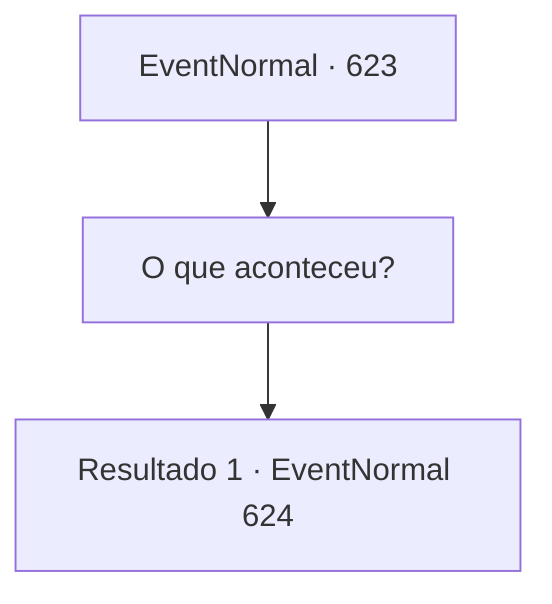

# Eventos normais · 623

[Índice da tabela](index.md) · [Índice geral](../index.md)

ID: `pt:EventNormal:623` · Fonte: `EventNormal4` · Versão: 1.2.47.

Mapeamento estático dos arquivos; a disponibilidade e a execução dependem do estado da run.

## Texto do evento

*Sem texto no arquivo.*

## Dados de entrada

```json
{
  "id": 623,
  "grade": 1,
  "place": "",
  "required": ""
}
```

## Mapa das escolhas



## Escolhas e resultados

### Escolha 1

O que aconteceu?

Requisitos e outros campos da escolha:

```json
{
  "required": ""
}
```

#### Resultado 1.1

Você pergunta à menina o que aconteceu. Então a menina responde enquanto mastiga sua comida. 

 "Os adultos dizem que o Cavaleiro Negro chegou... Não apenas a esta cidade, mas a outros lugares também..."

 Segundo ela, o Cavaleiro Negro monta um cavalo negro esquelético e carrega uma balança em vez de uma espada ou lança. E desde que apareceu, tudo na aldeia mudou. 

 "Tudo secou. Todos estão ficando cada vez mais famintos e ferozes... No final, as pessoas começam a se comer... Eu me escondo no depósito subterrâneo."

 Ela se esconde no depósito e resiste por semanas. 

 "No começo, eu como a comida do depósito. Depois, quando a comida acaba, eu pego e como ratos ou insetos..."

 Ela está exausta de fome e só sai depois de se resignar à morte.

Continuação registrada: [Evento 624](0624.md) na mesma tabela.

```json
{
  "required": "",
  "chance": "1",
  "nextEvent": 624,
  "type": 2,
  "reward": ""
}
```

## Referências que chegam a este evento

- [Evento 622 · escolha 1 · resultado 1](0622.md#escolha-1)
- [Evento 622 · escolha 1 · resultado 2](0622.md#escolha-1)
