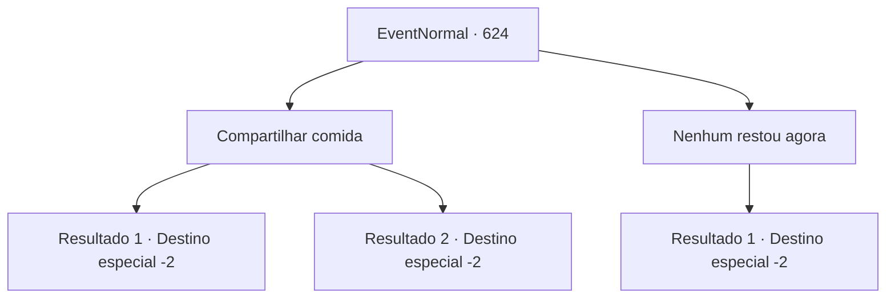

# Eventos normais · 624

[Índice da tabela](index.md) · [Índice geral](../index.md)

ID: `pt:EventNormal:624` · Fonte: `EventNormal4` · Versão: 1.2.47.

Mapeamento estático dos arquivos; a disponibilidade e a execução dependem do estado da run.

## Texto do evento

*Sem texto no arquivo.*

## Dados de entrada

```json
{
  "id": 624,
  "grade": 1,
  "place": "",
  "required": ""
}
```

## Mapa das escolhas



## Escolhas e resultados

### Escolha 1

Compartilhar comida

Requisitos e outros campos da escolha:

```json
{
  "required": "-1|23_0_1|23_10_1"
}
```

#### Resultado 1.1

Você compartilha comida com a garota novamente. Ela devora vorazmente mais uma vez e só para de comer compulsivamente quando seu estômago está cheio e inchado. 

 "O... obrigada por me salvar... Eu definitivamente vou retribuir mais tarde."

 Ela expressa sua gratidão com uma profunda reverência. Então, ela retorna à casa velha e em ruínas.

Continuação registrada: [Destino especial `-2`](../destinos-especiais.md).

```json
{
  "required": "23_0_1",
  "chance": "1",
  "nextEvent": -2,
  "type": 2,
  "reward": "5_837_2|25_0_1"
}
```

#### Resultado 1.2

Você compartilha comida com a garota novamente. Ela devora vorazmente mais uma vez e só para de comer compulsivamente quando seu estômago está cheio e inchado. 

 "O... obrigada por me salvar... Eu definitivamente vou retribuir mais tarde."

 Ela expressa sua gratidão com uma profunda reverência. Então, ela retorna à casa velha e em ruínas.

Continuação registrada: [Destino especial `-2`](../destinos-especiais.md).

```json
{
  "required": "23_10_1",
  "chance": "1",
  "nextEvent": -2,
  "type": 2,
  "reward": "5_837_2|25_10_1"
}
```

### Escolha 2

Nenhum restou agora

Requisitos e outros campos da escolha:

```json
{
  "required": ""
}
```

#### Resultado 2.1

Você diz à garota que não há mais e balança a cabeça. Um olhar momentâneo de decepção cruza o rosto da garota, mas ela se inclina profundamente para expressar sua gratidão. 

 "O... obrigado por me salvar..."

 Então, ainda segurando seu estômago roncando, ela retorna à casa dilapidada que está caindo aos pedaços.

Continuação registrada: [Destino especial `-2`](../destinos-especiais.md).

```json
{
  "required": "",
  "chance": "1",
  "nextEvent": -2,
  "type": 2,
  "reward": "5_837_9"
}
```

## Referências que chegam a este evento

- [Evento 623 · escolha 1 · resultado 1](0623.md#escolha-1)
