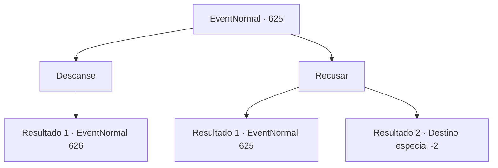

# Eventos normais · 625

[Índice da tabela](index.md) · [Índice geral](../index.md)

ID: `pt:EventNormal:625` · Fonte: `EventNormal4` · Versão: 1.2.47.

Mapeamento estático dos arquivos; a disponibilidade e a execução dependem do estado da run.

## Texto do evento

Você atravessa um deserto árido. Nenhuma floresta, nem mesmo uma única folha de grama cresce aqui, e ele carrega esse apelido há séculos. Apressando seus passos, você avista um antigo edifício de madeira tremeluzindo na névoa de calor. Dentro está um sacerdote magro, sozinho. Quando ele te vê, se aproxima com um sorriso gentil. 

 "Bem-vindo, irmão. Você deve estar cansado de suas viagens. Por que não descansa aqui por um tempo?"


## Dados de entrada

```json
{
  "id": 625,
  "grade": 1,
  "place": "",
  "required": "5_843_1|5_835_0"
}
```

## Mapa das escolhas



## Escolhas e resultados

### Escolha 1

Descanse

Requisitos e outros campos da escolha:

```json
{
  "required": ""
}
```

#### Resultado 1.1

Você aceita o favor dele e entra na igreja. O padre te guia até a sala de jantar e logo serve uma refeição. É um pedaço de pão seco, um pedaço de queijo e meia garrafa de vinho. 

 "Por favor, vá em frente e coma."

 Você olha para a mesa do padre. Há apenas um copo de água morna no lugar dele.

Continuação registrada: [Evento 626](0626.md) na mesma tabela.

```json
{
  "required": "",
  "chance": "1",
  "nextEvent": 626,
  "type": 2,
  "reward": ""
}
```

### Escolha 2

Recusar

Requisitos e outros campos da escolha:

```json
{
  "required": ""
}
```

#### Resultado 2.1

Você recusa a oferta e tenta continuar sua jornada. Então o padre agarra seu ombro e diz com uma voz trêmula. 

 "E-espere um momento, irmão. Vai demorar muito para chegar à cidade. Por que você não descansa aqui por um tempo?"


Continuação registrada: [Evento 625](0625.md) na mesma tabela.

```json
{
  "required": "5_839_0",
  "chance": "1",
  "nextEvent": 625,
  "type": 2,
  "reward": "5_839_1"
}
```

#### Resultado 2.2

Você recusa a oferta novamente e passa pela igreja. O padre só pode assistir você partir, incapaz de segurá-lo por mais tempo. Depois de caminhar por um tempo, você se vira, sentindo uma inquietação inexplicável. O padre, parecendo um ponto na distância, ainda está observando você, enviando um olhar arrepiante de arrependimento. Você sente seus pelos se arrepiarem e rapidamente deixa o lugar.

Continuação registrada: [Destino especial `-2`](../destinos-especiais.md).

```json
{
  "required": "5_839_1",
  "chance": "1",
  "nextEvent": -2,
  "type": 2,
  "reward": "5_835_9"
}
```

## Referências que chegam a este evento

- [Evento 625 · escolha 2 · resultado 1](0625.md#escolha-2)
