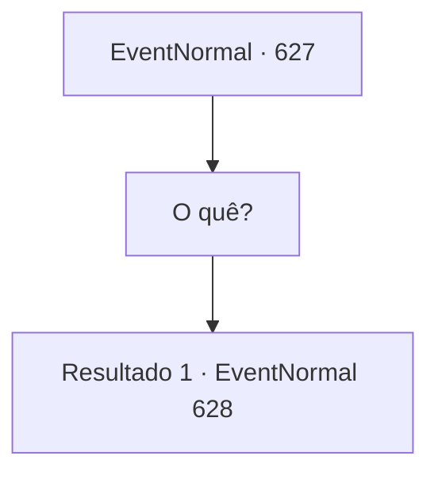

# Eventos normais · 627

[Índice da tabela](index.md) · [Índice geral](../index.md)

ID: `pt:EventNormal:627` · Fonte: `EventNormal4` · Versão: 1.2.47.

Mapeamento estático dos arquivos; a disponibilidade e a execução dependem do estado da run.

## Texto do evento

*Sem texto no arquivo.*

## Dados de entrada

```json
{
  "id": 627,
  "grade": 1,
  "place": "",
  "required": ""
}
```

## Mapa das escolhas



## Escolhas e resultados

### Escolha 1

O quê?

Requisitos e outros campos da escolha:

```json
{
  "required": ""
}
```

#### Resultado 1.1

Vendo seu estado intacto, ele mostra uma expressão de confusão no rosto. 

 "Devem ter sido pílulas para dormir... Por que você está bem?"

 Ele murmura para si mesmo, então levanta o porrete na mão e encara você. 

 "Você não é um humano comum. Nesse caso..."

 Então ele balança o porrete com um sorriso largo o suficiente para rasgar sua boca. <color=red>

 "Este é o sustento concedido a mim por Deus!"

</color>

Continuação registrada: [Evento 628](0628.md) na mesma tabela.

```json
{
  "required": "",
  "chance": "1",
  "nextEvent": 628,
  "type": 2,
  "reward": "6_0_38",
  "place": 10
}
```

## Referências que chegam a este evento

- [Evento 626 · escolha 1 · resultado 1](0626.md#escolha-1)
- [Evento 626 · escolha 1 · resultado 3](0626.md#escolha-1)
- [Evento 630 · escolha 1 · resultado 1](0630.md#escolha-1)
- [Evento 630 · escolha 1 · resultado 3](0630.md#escolha-1)
