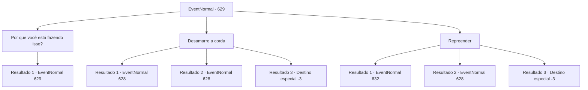

# Eventos normais · 629

[Índice da tabela](index.md) · [Índice geral](../index.md)

ID: `pt:EventNormal:629` · Fonte: `EventNormal4` · Versão: 1.2.47.

Mapeamento estático dos arquivos; a disponibilidade e a execução dependem do estado da run.

## Texto do evento

*Sem texto no arquivo.*

## Dados de entrada

```json
{
  "id": 629,
  "grade": 1,
  "place": "",
  "required": ""
}
```

## Mapa das escolhas



## Escolhas e resultados

### Escolha 1

Por que você está fazendo isso?

Requisitos e outros campos da escolha:

```json
{
  "required": "5_840_0"
}
```

#### Resultado 1.1

Você pergunta ao padre por que ele está fazendo isso. Então ele olha para o céu por um momento e diz. 

 "...Isso é um castigo do deus da fome. Ele cavalga um poderoso cavalo negro, carregando uma balança com seu corpo esquelético. E ele traz fome e pune os humanos gananciosos."

 O padre responde à sua pergunta e se aproxima lentamente. Então ele levanta o porrete em sua mão e olha fixamente para você. 

 "E como um mero humano, eu... não posso mais suportar essa fome, essa provação."


Continuação registrada: [Evento 629](0629.md) na mesma tabela.

```json
{
  "required": "",
  "chance": "1",
  "nextEvent": 629,
  "type": 2,
  "reward": "5_840_1"
}
```

### Escolha 2

Desamarre a corda

Requisitos e outros campos da escolha:

```json
{
  "required": ""
}
```

#### Resultado 2.1


 "Por favor, entenda."

 O padre diz com um sorriso triste. <color=red>

 "Que eu quero comer sua carne."

</color> O porrete levantado balança em sua direção. Nesse momento, você quebra a corda e contra-ataca. O padre hesita como se estivesse surpreso, mas não pode desistir da refeição e avança.

Continuação registrada: [Evento 628](0628.md) na mesma tabela.

```json
{
  "required": "",
  "chance": "1|0_5_1",
  "nextEvent": 628,
  "type": 0,
  "reward": "6_0_38",
  "place": 7
}
```

#### Resultado 2.2


 "Por favor, entenda."

 O padre diz com um sorriso triste. <color=red>

 "Que eu quero comer sua carne."

</color> O porrete levantado balança em sua direção. Você tenta desamarrar a corda, mas falha, e cai após ser espancado várias vezes. Como resultado, a velha cadeira de madeira quebra, libertando seu corpo. O padre hesita como se estivesse surpreso, mas não desiste da refeição e ataca.

Continuação registrada: [Evento 628](0628.md) na mesma tabela.

```json
{
  "required": "1_0_2",
  "chance": "10",
  "nextEvent": 628,
  "type": 1,
  "reward": "0_0_-1|6_0_38",
  "place": 7
}
```

#### Resultado 2.3


 "Por favor, entenda."

 O padre diz com um sorriso triste. <color=red>

 "Que eu quero comer sua carne."

</color> O porrete levantado balança em sua direção. Você tenta desamarrar a corda, mas falha, e após ser espancado várias vezes, você cai. Então você perde a consciência.

Continuação registrada: [Destino especial `-3`](../destinos-especiais.md).

```json
{
  "required": "2_0_2",
  "chance": "10",
  "nextEvent": -3,
  "type": 1,
  "reward": "0_0_-1"
}
```

### Escolha 3

Repreender

Requisitos e outros campos da escolha:

```json
{
  "required": ""
}
```

#### Resultado 3.1

Você o repreende severamente e amaldiçoa que sua alma cairá no inferno mais doloroso. Então, seu rosto fica pálido de medo, e ele desaba, começando a soluçar. 

 "O que devo fazer sobre essa fome?"

 ele grita com a garganta seca. 

 "Muitas pessoas morreram de fome, e eu estou faminto há muito tempo... Já matei pessoas e comi seus cadáveres para saciar minha fome. Várias vezes. Várias vezes!"

 O padre que confessou seus pecados desamarra a corda que o prende. Então, abaixando a cabeça até o chão, ele diz. 

 "Eu... não posso mais viver assim. Por favor, me mate."


Continuação registrada: [Evento 632](0632.md) na mesma tabela.

```json
{
  "required": "",
  "chance": "1|0_12_1",
  "nextEvent": 632,
  "type": 0,
  "reward": ""
}
```

#### Resultado 3.2

Você o repreende. No entanto, ele apenas balança a cabeça lentamente. 

 "Por favor, entenda."

 O padre diz com um sorriso triste. <color=red>

 "Que eu quero comer sua carne."

</color> O porrete levantado balança em sua direção. Você tenta desamarrar a corda, mas falha, e cai após ser espancado várias vezes. Como resultado, a velha cadeira de madeira se quebra, libertando seu corpo. O padre hesita como se estivesse surpreso, mas não desiste da refeição e ataca.

Continuação registrada: [Evento 628](0628.md) na mesma tabela.

```json
{
  "required": "1_0_2",
  "chance": "30",
  "nextEvent": 628,
  "type": 1,
  "reward": "0_0_-1|6_0_38",
  "place": 7
}
```

#### Resultado 3.3

Você o repreende. No entanto, ele apenas balança a cabeça lentamente. 

 "Por favor, entenda."

 O padre diz com um sorriso triste. <color=red>

 "Que eu quero comer sua carne."

</color> O porrete levantado balança em sua direção. Você tenta desamarrar a corda, mas falha, e após ser espancado várias vezes, você cai. Então você perde a consciência.

Continuação registrada: [Destino especial `-3`](../destinos-especiais.md).

```json
{
  "required": "2_0_2",
  "chance": "30",
  "nextEvent": -3,
  "type": 1,
  "reward": "0_0_-1"
}
```

## Referências que chegam a este evento

- [Evento 626 · escolha 1 · resultado 2](0626.md#escolha-1)
- [Evento 629 · escolha 1 · resultado 1](0629.md#escolha-1)
- [Evento 630 · escolha 1 · resultado 2](0630.md#escolha-1)
