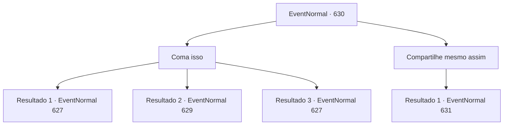

# Eventos normais · 630

[Índice da tabela](index.md) · [Índice geral](../index.md)

ID: `pt:EventNormal:630` · Fonte: `EventNormal4` · Versão: 1.2.47.

Mapeamento estático dos arquivos; a disponibilidade e a execução dependem do estado da run.

## Texto do evento

*Sem texto no arquivo.*

## Dados de entrada

```json
{
  "id": 630,
  "grade": 1,
  "place": "",
  "required": ""
}
```

## Mapa das escolhas



## Escolhas e resultados

### Escolha 1

Coma isso

Requisitos e outros campos da escolha:

```json
{
  "required": ""
}
```

#### Resultado 1.1

Você dá uma mordida no pão e a engole com vinho. A textura seca do pão e o amargor doce do vinho se espalham em sua boca. Observando você, o padre murmura baixinho. 

 "Por favor, entenda, irmão. Não havia outra escolha."

 Logo depois, o padre se levanta e tira um porrete escondido. Ele se aproxima de você com um sorriso arrepiante.

Continuação registrada: [Evento 627](0627.md) na mesma tabela.

```json
{
  "required": "21_15_3",
  "chance": "1|0_13_1",
  "nextEvent": 627,
  "type": 0,
  "reward": ""
}
```

#### Resultado 1.2

Você dá uma mordida no pão e a desce com vinho. A textura seca e a doçura sutil se espalham em sua boca. É nesse momento. De repente, sua visão fica turva e uma sonolência intensa toma conta de você. Incapaz de lutar contra a sonolência, você perde a consciência.  Quando você acorda de repente, está em um lugar subterrâneo. Seu corpo está amarrado a um grande pilar de madeira, e à sua frente, um padre está afiando uma adaga. 

 "...Você despertou. Teria sido mais confortável se você tivesse continuado dormindo..."

 O padre murmura, coloca a adaga de lado e pega um porrete. 

 "Por favor, entenda, irmão. Não havia outra escolha."

 Ele se aproxima de você com um sorriso arrepiante.

Continuação registrada: [Evento 629](0629.md) na mesma tabela.

```json
{
  "required": "21_15_3",
  "chance": "15",
  "nextEvent": 629,
  "type": 1,
  "reward": "6_0_38",
  "place": 7
}
```

#### Resultado 1.3

Você dá uma mordida no pão e a engole com vinho. A textura seca do pão e o amargor doce do vinho se espalham em sua boca. Observando você, o padre murmura baixinho. 

 "Por favor, entenda, irmão. Não havia outra escolha."

 Logo depois, o padre se levanta e tira um porrete escondido. Ele se aproxima de você com um sorriso arrepiante.

Continuação registrada: [Evento 627](0627.md) na mesma tabela.

```json
{
  "required": "20_15_3",
  "chance": "1",
  "nextEvent": 627,
  "type": 2,
  "reward": ""
}
```

### Escolha 2

Compartilhe mesmo assim

Requisitos e outros campos da escolha:

```json
{
  "required": "1_3_15"
}
```

#### Resultado 2.1

Você oferece pão e queijo a ele mais uma vez. O padre lança um olhar dolorido e balança o braço com força para derrubar a mesa. Com um barulho alto, os pratos se quebram, e o pão e o queijo rolam no chão. 

 "Pare! Pare...! Por favor, não faça isso..."

 O padre, que estava olhando para eles, senta-se e soluça. 

 "Você ainda não entende? Estou tentando enganá-lo. Dando-lhe vinho misturado com um sonífero..."

 Uma lágrima escorre por seu rosto distorcido. <color=red>

 "... Estou tentando comer o cadáver. Para encher meu estômago faminto!"

</color>

Continuação registrada: [Evento 631](0631.md) na mesma tabela.

```json
{
  "required": "",
  "chance": "1",
  "nextEvent": 631,
  "type": 2,
  "reward": ""
}
```

## Referências que chegam a este evento

- [Evento 626 · escolha 2 · resultado 1](0626.md#escolha-2)
