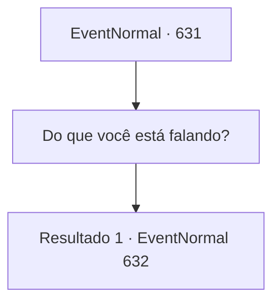

# Eventos normais · 631

[Índice da tabela](index.md) · [Índice geral](../index.md)

ID: `pt:EventNormal:631` · Fonte: `EventNormal4` · Versão: 1.2.47.

Mapeamento estático dos arquivos; a disponibilidade e a execução dependem do estado da run.

## Texto do evento

*Sem texto no arquivo.*

## Dados de entrada

```json
{
  "id": 631,
  "grade": 1,
  "place": "",
  "required": ""
}
```

## Mapa das escolhas



## Escolhas e resultados

### Escolha 1

Do que você está falando?

Requisitos e outros campos da escolha:

```json
{
  "required": ""
}
```

#### Resultado 1.1

Ele grita com a garganta seca e diz. 

 "Muitas pessoas morrem de fome, e eu estou faminto há muito tempo... Eu já matei pessoas e comi seus cadáveres para saciar minha fome. Várias vezes. Várias vezes!"

 O padre que confessa seus pecados olha para você e abaixa a cabeça, dizendo. 

 "Eu sobrevivo porque me falta coragem para morrer, mas... Eu não posso continuar assim. Por favor, me mate."


Continuação registrada: [Evento 632](0632.md) na mesma tabela.

```json
{
  "required": "",
  "chance": "1",
  "nextEvent": 632,
  "type": 2,
  "reward": ""
}
```

## Referências que chegam a este evento

- [Evento 630 · escolha 2 · resultado 1](0630.md#escolha-2)
