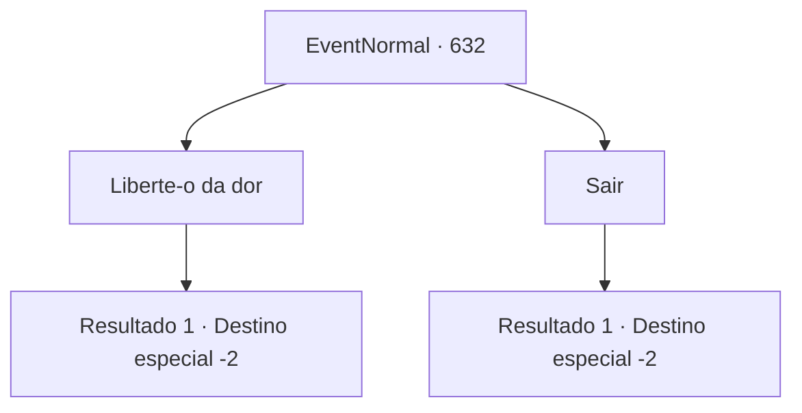

# Eventos normais · 632

[Índice da tabela](index.md) · [Índice geral](../index.md)

ID: `pt:EventNormal:632` · Fonte: `EventNormal4` · Versão: 1.2.47.

Mapeamento estático dos arquivos; a disponibilidade e a execução dependem do estado da run.

## Texto do evento

*Sem texto no arquivo.*

## Dados de entrada

```json
{
  "id": 632,
  "grade": 1,
  "place": "",
  "required": ""
}
```

## Mapa das escolhas



## Escolhas e resultados

### Escolha 1

Liberte-o da dor

Requisitos e outros campos da escolha:

```json
{
  "required": ""
}
```

#### Resultado 1.1

Você liberta o padre da fome como deseja. O padre caído olha para o teto com os olhos turvos e encontra seu fim. Você fecha seus olhos e sai silenciosamente da igreja.

Continuação registrada: [Destino especial `-2`](../destinos-especiais.md).

```json
{
  "required": "",
  "chance": "1",
  "nextEvent": -2,
  "type": 2,
  "reward": "5_835_9"
}
```

### Escolha 2

Sair

Requisitos e outros campos da escolha:

```json
{
  "required": ""
}
```

#### Resultado 2.1

Você recusa o pedido do padre. Ele implora várias vezes, mas você não ouve. Você dá as costas e sai da igreja, abandonando o pecador em vestes sacerdotais.

Continuação registrada: [Destino especial `-2`](../destinos-especiais.md).

```json
{
  "required": "",
  "chance": "1",
  "nextEvent": -2,
  "type": 2,
  "reward": "5_835_9"
}
```

## Referências que chegam a este evento

- [Evento 629 · escolha 3 · resultado 1](0629.md#escolha-3)
- [Evento 631 · escolha 1 · resultado 1](0631.md#escolha-1)
