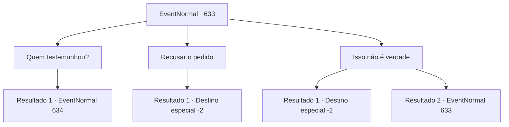

# Eventos normais · 633

[Índice da tabela](index.md) · [Índice geral](../index.md)

ID: `pt:EventNormal:633` · Fonte: `EventNormal4` · Versão: 1.2.47.

Mapeamento estático dos arquivos; a disponibilidade e a execução dependem do estado da run.

## Texto do evento

Você passa por uma vila envolta em uma penumbra assustadora. O lugar se chama 'Odilan', e gemidos de dor ecoam por todas as ruas. Crianças e idosos estão caídos com febres ardentes, enquanto até mesmo os adultos mais fortes suspiram impotentes, sem saber o que fazer. Um velho—com a voz seca e trêmula—se dirige a você. 

 "…Por favor… nos ajude."

 Com um olhar suplicante, ele continua, 

 "Alguém diz ter visto um unicórnio nas montanhas. Ouvi dizer que seu sangue pode curar esta praga. Então, por favor… você capturaria o unicórnio para nós?"


## Dados de entrada

```json
{
  "id": 633,
  "grade": 1,
  "place": "",
  "required": "5_841_1|5_830_0"
}
```

## Mapa das escolhas



## Escolhas e resultados

### Escolha 1

Quem testemunhou?

Requisitos e outros campos da escolha:

```json
{
  "required": ""
}
```

#### Resultado 1.1

O velho afirma que o caçador 'Hans' testemunha um unicórnio. Você segue suas orientações para encontrar Hans. E você o encontra em uma cabana precária localizada na beira da floresta. Para ser preciso, você encontra o cadáver de Hans. Seu corpo está coberto de manchas pretas. O velho estala a língua, dizendo que essas coisas são comuns hoje em dia. 

 "Oh céus... tsk tsk... ele foi primeiro..."

 Ele olha ao redor e encontra o diário de Hans. 

 "Não consigo ler porque minha visão está ruim... dê uma olhada nisso. Deve conter o relato da visão do unicórnio."


Continuação registrada: [Evento 634](0634.md) na mesma tabela.

```json
{
  "required": "",
  "chance": "1",
  "nextEvent": 634,
  "type": 2,
  "reward": ""
}
```

### Escolha 2

Recusar o pedido

Requisitos e outros campos da escolha:

```json
{
  "required": ""
}
```

#### Resultado 2.1

Você recusa o pedido dele. O velho solta um suspiro de decepção. Mesmo assim, você se afasta dele e vai embora.

Continuação registrada: [Destino especial `-2`](../destinos-especiais.md).

```json
{
  "required": "",
  "chance": "1",
  "nextEvent": -2,
  "type": 2,
  "reward": "5_830_2"
}
```

### Escolha 3

Isso não é verdade

Requisitos e outros campos da escolha:

```json
{
  "required": "1_7_14|5_834_0"
}
```

#### Resultado 3.1

Você se lembra de que o sangue de unicórnio não pode curar a praga e que ferir um unicórnio traz uma maldição. Você explica isso calmamente ao velho e diz que não pode capturar um unicórnio. O velho solta um suspiro desapontado. 

 "Eu... eu entendo..."

 Você se despede do velho e deixa a aldeia.

Continuação registrada: [Destino especial `-2`](../destinos-especiais.md).

```json
{
  "required": "",
  "chance": "1|0_12_1",
  "nextEvent": -2,
  "type": 0,
  "reward": "5_830_2"
}
```

#### Resultado 3.2

Você se lembra de que o sangue de unicórnio não pode curar a praga e que ferir um unicórnio traz uma maldição. Você explica isso calmamente ao velho e diz que não pode capturar um unicórnio. No entanto, o velho não muda de ideia depois de ouvi-lo. 

 "Você não saberá até tentar por si mesmo. É uma criatura mística, então deve haver algum efeito do seu sangue..!"


Continuação registrada: [Evento 633](0633.md) na mesma tabela.

```json
{
  "required": "",
  "chance": "20",
  "nextEvent": 633,
  "type": 1,
  "reward": "5_834_1"
}
```

## Referências que chegam a este evento

- [Evento 633 · escolha 3 · resultado 2](0633.md#escolha-3)
