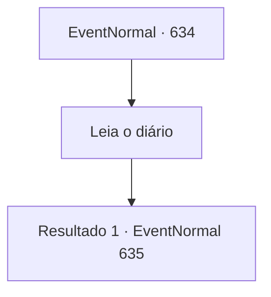

# Eventos normais · 634

[Índice da tabela](index.md) · [Índice geral](../index.md)

ID: `pt:EventNormal:634` · Fonte: `EventNormal4` · Versão: 1.2.47.

Mapeamento estático dos arquivos; a disponibilidade e a execução dependem do estado da run.

## Texto do evento

*Sem texto no arquivo.*

## Dados de entrada

```json
{
  "id": 634,
  "grade": 1,
  "place": "",
  "required": ""
}
```

## Mapa das escolhas



## Escolhas e resultados

### Escolha 1

Leia o diário

Requisitos e outros campos da escolha:

```json
{
  "required": ""
}
```

#### Resultado 1.1

No diário do caçador Hans, há uma história sobre a visão de um unicórnio. Diz que Hans descobre uma pelagem branca brilhante na floresta ao anoitecer, e ao segui-la, ele vê um unicórnio. Você fecha o diário e vai direto para a floresta. A floresta localizada atrás da cabana é repleta de árvores coníferas densas, e o chão está coberto de musgo e cogumelos. Na floresta escura, você encontra uma pelagem branca brilhante. Parece ser a pelagem do unicórnio mencionado no diário de Hans.

Continuação registrada: [Evento 635](0635.md) na mesma tabela.

```json
{
  "required": "",
  "chance": "1",
  "nextEvent": 635,
  "type": 2,
  "reward": ""
}
```

## Referências que chegam a este evento

- [Evento 633 · escolha 1 · resultado 1](0633.md#escolha-1)
