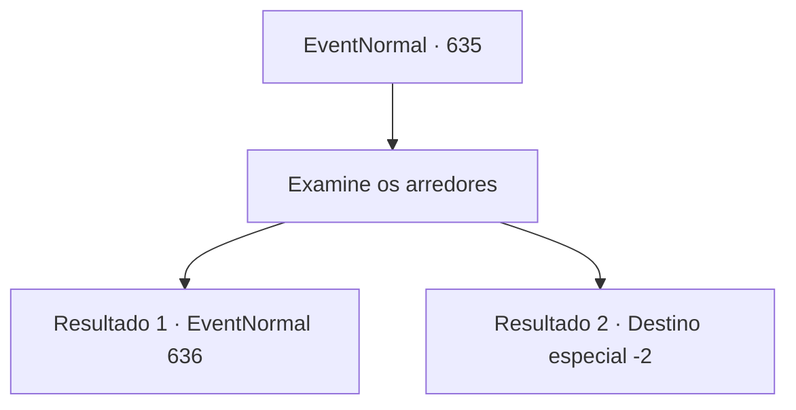

# Eventos normais · 635

[Índice da tabela](index.md) · [Índice geral](../index.md)

ID: `pt:EventNormal:635` · Fonte: `EventNormal4` · Versão: 1.2.47.

Mapeamento estático dos arquivos; a disponibilidade e a execução dependem do estado da run.

## Texto do evento

*Sem texto no arquivo.*

## Dados de entrada

```json
{
  "id": 635,
  "grade": 1,
  "place": "",
  "required": ""
}
```

## Mapa das escolhas



## Escolhas e resultados

### Escolha 1

Examine os arredores

Requisitos e outros campos da escolha:

```json
{
  "required": ""
}
```

#### Resultado 1.1

Você encontra pegadas em um lugar espalhado com pelo branco puro. O solo úmido e o musgo mantêm a forma dos cascos, e os rastros levam a um riacho de fluxo tênue. E lá, você encontra uma rena branca pura. O que Hans vê não é um unicórnio. Ela tem apenas um chifre restante, e o outro está quebrado ou não é visível. A rena branca, alheia à sua presença, abaixa a cabeça e pastoreia no musgo.

Continuação registrada: [Evento 636](0636.md) na mesma tabela.

```json
{
  "required": "",
  "chance": "1|0_14_1",
  "nextEvent": 636,
  "type": 0,
  "reward": ""
}
```

#### Resultado 1.2

Você investiga o local onde a pelagem branca pura está espalhada, mas não encontra nenhum outro vestígio além da pelagem. No final, você apenas perde tempo vagando na floresta e não consegue encontrar o unicórnio. Você retorna à aldeia e entrega essa notícia ao velho. Então ele solta um longo suspiro. 

 "... Não há o que fazer. É uma pena, mas você fez o seu melhor."

 Você se despede do velho e deixa a aldeia.

Continuação registrada: [Destino especial `-2`](../destinos-especiais.md).

```json
{
  "required": "",
  "chance": "12",
  "nextEvent": -2,
  "type": 1,
  "reward": "5_830_2"
}
```

## Referências que chegam a este evento

- [Evento 634 · escolha 1 · resultado 1](0634.md#escolha-1)
