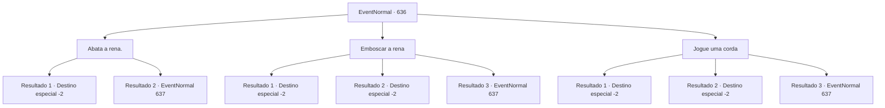

# Eventos normais · 636

[Índice da tabela](index.md) · [Índice geral](../index.md)

ID: `pt:EventNormal:636` · Fonte: `EventNormal4` · Versão: 1.2.47.

Mapeamento estático dos arquivos; a disponibilidade e a execução dependem do estado da run.

## Texto do evento

*Sem texto no arquivo.*

## Dados de entrada

```json
{
  "id": 636,
  "grade": 1,
  "place": "",
  "required": ""
}
```

## Mapa das escolhas



## Escolhas e resultados

### Escolha 1

Abata a rena.

Requisitos e outros campos da escolha:

```json
{
  "required": "20_6_1"
}
```

#### Resultado 1.1

Você atira no pescoço da rena e a derruba com um só golpe. O pelo da rena branca está manchado com sangue vermelho escuro, e você coleta o sangue da rena e retorna à aldeia. O velho olha para o sangue com um sorriso alegre. 

 "Oh..! Este é o sangue do unicórnio!"

 Ele pega o sangue da rena de você e grita por toda a aldeia. 

 "Aqui, {1} nos trouxe o sangue do unicórnio!"

 O velho, com um rosto cheio de certeza de que a praga será curada, compartilha o sangue com os aldeões. Então ele volta para você, segura suas mãos e expressa repetidamente sua gratidão. 

 "Obrigado! Verdadeiramente, obrigado..!"

 Se a doença deles será curada ou não é desconhecido, mas você recebe uma recompensa do velho e deixa a aldeia.

Continuação registrada: [Destino especial `-2`](../destinos-especiais.md).

```json
{
  "required": "",
  "chance": "1|0_6_1",
  "nextEvent": -2,
  "type": 0,
  "reward": "0_3_3|0_4_40|5_830_2"
}
```

#### Resultado 1.2

Você atira no pescoço da rena. No entanto, a rena levanta a cabeça para evitar o tiro, se vira e foge de você. Você a persegue, mas a rena desaparece em algum lugar, sem deixar rastros. Eventualmente, você retorna à aldeia e encontra o velho novamente. Ele olha para você com olhos expectantes e pergunta. 

 "O que aconteceu com o unicórnio..?"


Continuação registrada: [Evento 637](0637.md) na mesma tabela.

```json
{
  "required": "",
  "chance": "16",
  "nextEvent": 637,
  "type": 1,
  "reward": ""
}
```

### Escolha 2

Emboscar a rena

Requisitos e outros campos da escolha:

```json
{
  "required": ""
}
```

#### Resultado 2.1

Você esconde sua presença e se aproxima da rena, atacando seu ponto vital e derrubando-a com um golpe. O pelo da rena branca está manchado com sangue vermelho escuro, e você coleta o sangue da rena e retorna à aldeia. O velho vê o sangue e sorri de alegria. 

 "Oh..! Este é o sangue do unicórnio!"

 Ele pega o sangue da rena de você e grita por toda a aldeia. 

 "Aqui, {1} nos trouxe o sangue do unicórnio!"

 O velho, com um rosto cheio de certeza de que a praga será curada, compartilha o sangue com os aldeões. Então ele retorna a você, segurando suas mãos e expressando repetidamente sua gratidão. 

 "Obrigado! Verdadeiramente, obrigado..!"

 Se a doença deles será curada ou não é desconhecido, mas você recebe uma recompensa do velho e deixa a aldeia.

Continuação registrada: [Destino especial `-2`](../destinos-especiais.md).

```json
{
  "required": "21_5_4",
  "chance": "1|0_6_1",
  "nextEvent": -2,
  "type": 0,
  "reward": "0_3_3|0_4_40|5_830_2"
}
```

#### Resultado 2.2

Você esconde sua presença e se aproxima da rena, atacando seu ponto vital e derrubando-a com um golpe. O pelo da rena branca está manchado com sangue vermelho escuro, e você coleta o sangue da rena e retorna à aldeia. O velho vê o sangue e sorri de alegria. 

 "Oh..! Este é o sangue do unicórnio!"

 Ele pega o sangue da rena de você e grita por toda a aldeia. 

 "Aqui, {1} nos trouxe o sangue do unicórnio!"

 O velho, com um rosto cheio de certeza de que a praga será curada, compartilha o sangue com os aldeões. Então ele retorna a você, segurando suas mãos e expressando repetidamente sua gratidão. 

 "Obrigado! Verdadeiramente, obrigado..!"

 Se a doença deles será curada ou não é desconhecido, mas você recebe uma recompensa do velho e deixa a aldeia.

Continuação registrada: [Destino especial `-2`](../destinos-especiais.md).

```json
{
  "required": "20_5_4",
  "chance": "1|0_6_2",
  "nextEvent": -2,
  "type": 0,
  "reward": "0_3_3|0_4_40|5_830_2"
}
```

#### Resultado 2.3

Você esconde sua presença e tenta se aproximar da rena. No entanto, a rena levanta a cabeça, te avista e foge. Você a persegue, mas a rena desaparece em algum lugar, sem deixar rastros. Eventualmente, você retorna à aldeia e encontra o velho novamente. Ele olha para você com olhos expectantes e pergunta. 

 "O que aconteceu com o unicórnio..?"


Continuação registrada: [Evento 637](0637.md) na mesma tabela.

```json
{
  "required": "",
  "chance": "32",
  "nextEvent": 637,
  "type": 1,
  "reward": ""
}
```

### Escolha 3

Jogue uma corda

Requisitos e outros campos da escolha:

```json
{
  "required": "8_39_1"
}
```

#### Resultado 3.1

Você joga a corda e a prende em volta do pescoço da rena. Então você a puxa, sufocando a rena. A rena branca luta e eventualmente desaba, dando seu último suspiro. Você coleta o sangue da rena e retorna à aldeia. O velho olha para o sangue com um sorriso alegre. 

 "Oh..! Este é o sangue do unicórnio!"

 Ele pega o sangue da rena de você e grita por toda a aldeia. 

 "Aqui, {1} nos trouxe o sangue do unicórnio!"

 O velho, com um rosto cheio de certeza de que a praga será curada, compartilha o sangue com os aldeões. Então ele volta para você, segurando suas mãos e expressando repetidamente sua gratidão. 

 "Obrigado! Verdadeiramente, obrigado..!"

 Se a doença deles será curada ou não é desconhecido, mas você recebe uma recompensa do velho e deixa a aldeia.

Continuação registrada: [Destino especial `-2`](../destinos-especiais.md).

```json
{
  "required": "21_60_2",
  "chance": "1|0_5_1",
  "nextEvent": -2,
  "type": 0,
  "reward": "0_3_3|0_4_40|5_830_2"
}
```

#### Resultado 3.2

Você joga a corda e a prende em volta do pescoço da rena. Então você a puxa, sufocando a rena. A rena branca luta e eventualmente desaba, dando seu último suspiro. Você coleta o sangue da rena e retorna à aldeia. O velho olha para o sangue com um sorriso alegre. 

 "Oh..! Este é o sangue do unicórnio!"

 Ele pega o sangue da rena de você e grita por toda a aldeia. 

 "Aqui, {1} nos trouxe o sangue do unicórnio!"

 O velho, com um rosto cheio de certeza de que a praga será curada, compartilha o sangue com os aldeões. Então ele volta para você, segurando suas mãos e expressando repetidamente sua gratidão. 

 "Obrigado! Verdadeiramente, obrigado..!"

 Se a doença deles será curada ou não é desconhecido, mas você recebe uma recompensa do velho e deixa a aldeia.

Continuação registrada: [Destino especial `-2`](../destinos-especiais.md).

```json
{
  "required": "20_60_4",
  "chance": "1|0_5_2",
  "nextEvent": -2,
  "type": 0,
  "reward": "0_3_3|0_4_40|5_830_2"
}
```

#### Resultado 3.3

Você joga a corda para pegar o pescoço da rena. No entanto, a corda cai nos arbustos antes de alcançá-la, e a rena levanta a cabeça, vê você e foge como um tiro. Você a persegue, mas a rena desaparece em algum lugar, sem deixar rastro. Eventualmente, você retorna à aldeia e encontra o velho novamente. Ele olha para você com olhos expectantes e pergunta. 

 "O que aconteceu com o unicórnio..?"


Continuação registrada: [Evento 637](0637.md) na mesma tabela.

```json
{
  "required": "",
  "chance": "16",
  "nextEvent": 637,
  "type": 1,
  "reward": ""
}
```

## Referências que chegam a este evento

- [Evento 635 · escolha 1 · resultado 1](0635.md#escolha-1)
