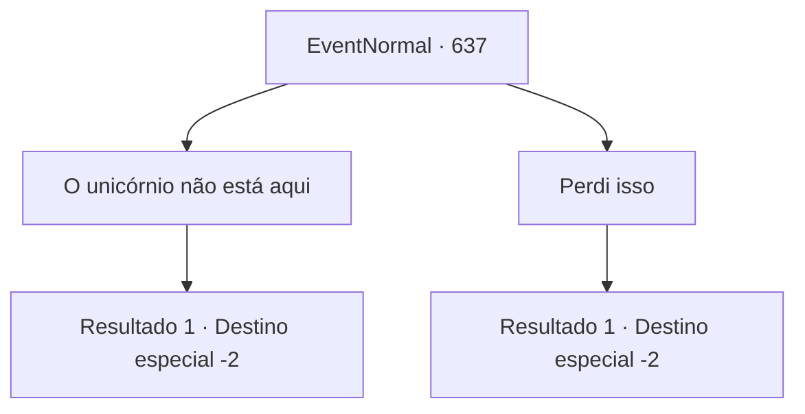

# Eventos normais · 637

[Índice da tabela](index.md) · [Índice geral](../index.md)

ID: `pt:EventNormal:637` · Fonte: `EventNormal4` · Versão: 1.2.47.

Mapeamento estático dos arquivos; a disponibilidade e a execução dependem do estado da run.

## Texto do evento

*Sem texto no arquivo.*

## Dados de entrada

```json
{
  "id": 637,
  "grade": 1,
  "place": "",
  "required": ""
}
```

## Mapa das escolhas



## Escolhas e resultados

### Escolha 1

O unicórnio não está aqui

Requisitos e outros campos da escolha:

```json
{
  "required": ""
}
```

#### Resultado 1.1

Você responde que não existia tal coisa como um unicórnio, e havia uma rena com pelo branco. O velho não consegue esconder sua expressão de grande decepção. 

 "Então o que Hans viu não era um unicórnio..? Ah... essa era a única esperança..."

 Você deixa a aldeia, deixando o velho desesperado para trás.

Continuação registrada: [Destino especial `-2`](../destinos-especiais.md).

```json
{
  "required": "",
  "chance": "1",
  "nextEvent": -2,
  "type": 2,
  "reward": "5_830_2"
}
```

### Escolha 2

Perdi isso

Requisitos e outros campos da escolha:

```json
{
  "required": ""
}
```

#### Resultado 2.1

Você diz que sente falta do unicórnio. Então ele suspira profundamente. 

 "... Não há o que fazer. É uma pena, mas você fez o seu melhor."

 Você se despede do velho e deixa a aldeia.

Continuação registrada: [Destino especial `-2`](../destinos-especiais.md).

```json
{
  "required": "",
  "chance": "1",
  "nextEvent": -2,
  "type": 2,
  "reward": "5_830_2"
}
```

## Referências que chegam a este evento

- [Evento 636 · escolha 1 · resultado 2](0636.md#escolha-1)
- [Evento 636 · escolha 2 · resultado 3](0636.md#escolha-2)
- [Evento 636 · escolha 3 · resultado 3](0636.md#escolha-3)
