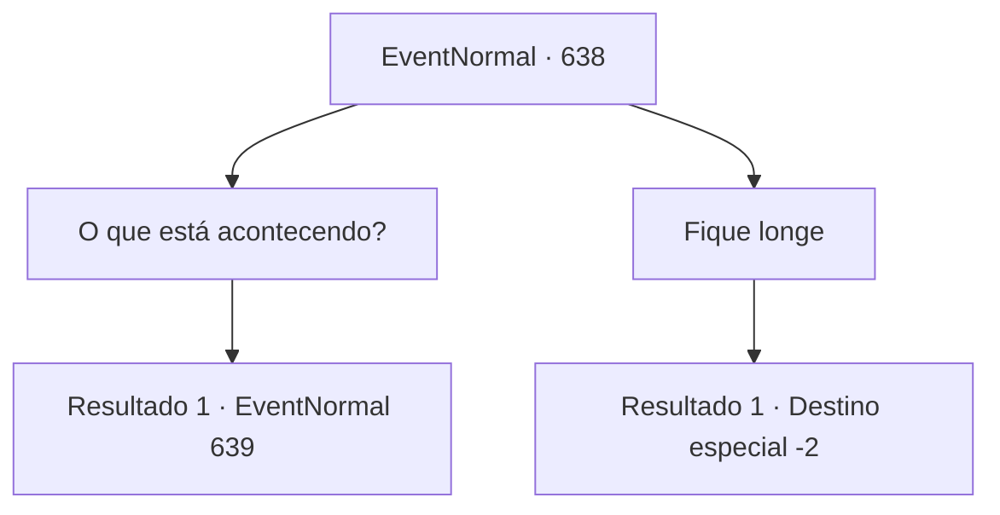

# Eventos normais · 638

[Índice da tabela](index.md) · [Índice geral](../index.md)

ID: `pt:EventNormal:638` · Fonte: `EventNormal4` · Versão: 1.2.47.

Mapeamento estático dos arquivos; a disponibilidade e a execução dependem do estado da run.

## Texto do evento

Você retorna à vila de Odilan, o lugar que você visitou antes. Além de sua cerca externa desgastada, vários jovens estão cavando no chão com pás, e ao lado deles há uma longa fileira de cadáveres envoltos em tecido amarelado.

## Dados de entrada

```json
{
  "id": 638,
  "grade": 1,
  "place": "",
  "required": "5_830_2"
}
```

## Mapa das escolhas



## Escolhas e resultados

### Escolha 1

O que está acontecendo?

Requisitos e outros campos da escolha:

```json
{
  "required": ""
}
```

#### Resultado 1.1

Você se aproxima deles e pergunta o que estão fazendo. Então, um dos jovens responde secamente com uma voz cansada. 

 "Tosse... Tosse! Ah, não está vendo? Estamos enterrando os mortos."

 Ele faz um gesto para você ir embora com um movimento irritado. 

 "Se não vai ajudar... Tosse!... Por favor, siga seu caminho."

 O jovem continua cavando enquanto tosse.

Continuação registrada: [Evento 639](0639.md) na mesma tabela.

```json
{
  "required": "",
  "chance": "1",
  "nextEvent": 639,
  "type": 2,
  "reward": "5_830_9"
}
```

### Escolha 2

Fique longe

Requisitos e outros campos da escolha:

```json
{
  "required": ""
}
```

#### Resultado 2.1

Você passa pelos jovens que estão cavando.

Continuação registrada: [Destino especial `-2`](../destinos-especiais.md).

```json
{
  "required": "",
  "chance": "1",
  "nextEvent": -2,
  "type": 2,
  "reward": "5_830_9"
}
```

## Referências que chegam a este evento

Nenhum `nextEvent` positivo da mesma tabela aponta para este nó. Isso não prova que seja inacessível: sorteio e estado de história podem selecioná-lo.

