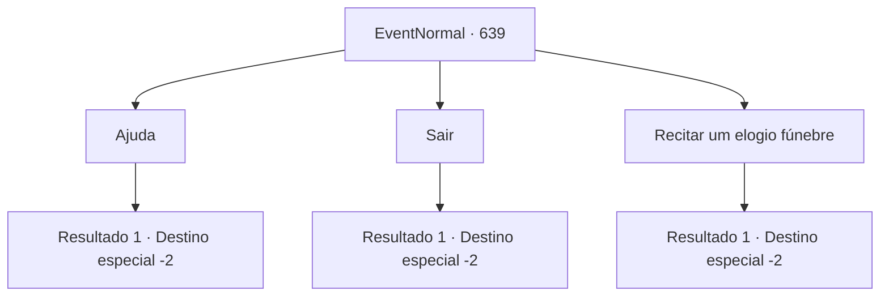

# Eventos normais · 639

[Índice da tabela](index.md) · [Índice geral](../index.md)

ID: `pt:EventNormal:639` · Fonte: `EventNormal4` · Versão: 1.2.47.

Mapeamento estático dos arquivos; a disponibilidade e a execução dependem do estado da run.

## Texto do evento

*Sem texto no arquivo.*

## Dados de entrada

```json
{
  "id": 639,
  "grade": 1,
  "place": "",
  "required": ""
}
```

## Mapa das escolhas



## Escolhas e resultados

### Escolha 1

Ajuda

Requisitos e outros campos da escolha:

```json
{
  "required": ""
}
```

#### Resultado 1.1

Você ajuda os jovens com a escavação, criando sepulturas para os aldeões. Inicialmente bruscos, eles expressam gratidão pela sua ajuda com uma atitude muito mais suave. 

 "Graças à sua ajuda, o trabalho é concluído rapidamente. Cof! Cof..! Obrigado."

 Você se despede deles e segue seu caminho.

Continuação registrada: [Destino especial `-2`](../destinos-especiais.md).

```json
{
  "required": "",
  "chance": "1",
  "nextEvent": -2,
  "type": 2,
  "reward": "5_830_9|0_3_2"
}
```

### Escolha 2

Sair

Requisitos e outros campos da escolha:

```json
{
  "required": ""
}
```

#### Resultado 2.1

Você se afasta dos jovens que estão cavando.

Continuação registrada: [Destino especial `-2`](../destinos-especiais.md).

```json
{
  "required": "",
  "chance": "1",
  "nextEvent": -2,
  "type": 2,
  "reward": "5_830_9"
}
```

### Escolha 3

Recitar um elogio fúnebre

Requisitos e outros campos da escolha:

```json
{
  "required": "1_7_14"
}
```

#### Resultado 3.1

Você se lembra dos elogios dos sacerdotes que viu antes e os recita para os aldeões falecidos. Os jovens olham para você e continuam cavando em silêncio. Depois de um tempo, um deles se aproxima e expressa gratidão. 

 "Você era um sacerdote... Obrigado. Tosse..! Somos todos ignorantes e não sabíamos como fazer isso."

 Ele lhe oferece uma pequena quantia de dinheiro, dizendo que não é muito, mas por favor aceite. Você aceita e se despede dos jovens.

Continuação registrada: [Destino especial `-2`](../destinos-especiais.md).

```json
{
  "required": "",
  "chance": "1",
  "nextEvent": -2,
  "type": 2,
  "reward": "5_830_9|0_3_2|0_4_5"
}
```

## Referências que chegam a este evento

- [Evento 638 · escolha 1 · resultado 1](0638.md#escolha-1)
