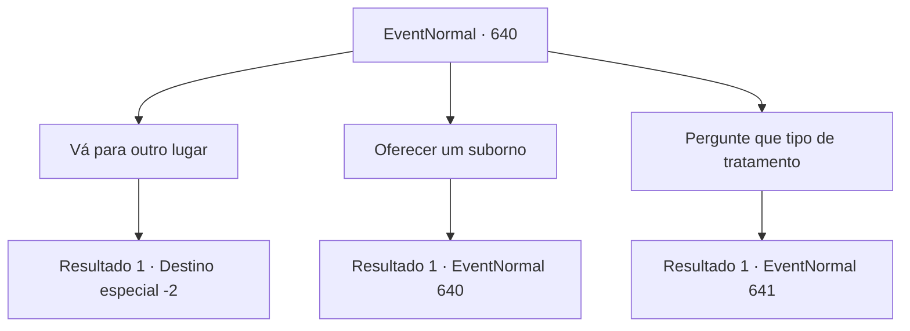

# Eventos normais · 640

[Índice da tabela](index.md) · [Índice geral](../index.md)

ID: `pt:EventNormal:640` · Fonte: `EventNormal4` · Versão: 1.2.47.

Mapeamento estático dos arquivos; a disponibilidade e a execução dependem do estado da run.

## Texto do evento

Você caminha por uma estrada larga o suficiente para carroças quando médicos da peste—rostos escondidos atrás de máscaras pretas em forma de bico, corpos envoltos em tecido—bloqueiam seu caminho. Paladinos armados estão ao lado deles. 

 "Esta estrada está selada. Você pode prosseguir apenas após receber o tratamento adequado."


## Dados de entrada

```json
{
  "id": 640,
  "grade": 1,
  "place": "",
  "required": "5_841_1|5_845_0"
}
```

## Mapa das escolhas



## Escolhas e resultados

### Escolha 1

Vá para outro lugar

Requisitos e outros campos da escolha:

```json
{
  "required": ""
}
```

#### Resultado 1.1

Você se afasta e vai para outro lugar, e eles não se incomodam em segui-lo.

Continuação registrada: [Destino especial `-2`](../destinos-especiais.md).

```json
{
  "required": "",
  "chance": "1",
  "nextEvent": -2,
  "type": 2,
  "reward": ""
}
```

### Escolha 2

Oferecer um suborno

Requisitos e outros campos da escolha:

```json
{
  "required": "5_846_0"
}
```

#### Resultado 2.1

Você tenta oferecer um suborno, mas o inspetor, percebendo isso, levanta a mão para te parar. 

 "Eles não aceitam nada."

 A atitude deles é firme.

Continuação registrada: [Evento 640](0640.md) na mesma tabela.

```json
{
  "required": "",
  "chance": "1",
  "nextEvent": 640,
  "type": 2,
  "reward": "5_846_1"
}
```

### Escolha 3

Pergunte que tipo de tratamento

Requisitos e outros campos da escolha:

```json
{
  "required": ""
}
```

#### Resultado 3.1

Quando você pergunta que tipo de tratamento é, um dos oficiais de quarentena responde. 

 "Primeiro, o paciente inala a fumaça que vem deste incensário. Depois, faço um furo no braço do paciente para retirar sangue. Em seguida, costuro a ferida, cauterizo-a com fogo e enrolo-a com uma bandagem embebida em remédio."

 Ele afirma que, ao fazer isso, a praga perde sua contagiosidade.

Continuação registrada: [Evento 641](0641.md) na mesma tabela.

```json
{
  "required": "",
  "chance": "1",
  "nextEvent": 641,
  "type": 2,
  "reward": ""
}
```

## Referências que chegam a este evento

- [Evento 640 · escolha 2 · resultado 1](0640.md#escolha-2)
