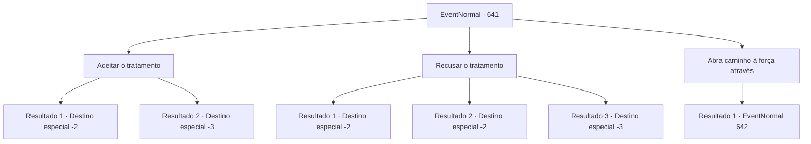

# Eventos normais · 641

[Índice da tabela](index.md) · [Índice geral](../index.md)

ID: `pt:EventNormal:641` · Fonte: `EventNormal4` · Versão: 1.2.47.

Mapeamento estático dos arquivos; a disponibilidade e a execução dependem do estado da run.

## Texto do evento

*Sem texto no arquivo.*

## Dados de entrada

```json
{
  "id": 641,
  "grade": 1,
  "place": "",
  "required": ""
}
```

## Mapa das escolhas



## Escolhas e resultados

### Escolha 1

Aceitar o tratamento

Requisitos e outros campos da escolha:

```json
{
  "required": ""
}
```

#### Resultado 1.1

Você decide receber o tratamento em silêncio. Então o oficial de quarentena te senta em uma cadeira de madeira e amarra suas mãos e pés. 

 "Agora. Inale a fumaça deste incensário."

 Ele traz um incensário de latão e derrama a fumaça branca que emana dele sobre você. Você sente sua consciência ficando um pouco turva. Então ele pega um prego embebido em álcool e perfura seu braço para tirar sangue. Parece que um espeto de ferro quente está te perfurando, mas graças à fumaça, você consegue suportar de alguma forma. Depois de um tempo, quando o sangramento para, o oficial de quarentena costura o ferimento e o cauteriza. Seu corpo treme, e o suor frio escorre como chuva. 

 "Agora está tudo feito."

 Ele pega uma bandagem úmida com um tom esverdeado e a enrola em seu ferimento. 

 "Você pode ir agora."

 O oficial de quarentena, tendo terminado o tratamento, te ajuda a levantar. Você segura seu braço dolorido e passa por eles.

Continuação registrada: [Destino especial `-2`](../destinos-especiais.md).

```json
{
  "required": "1_0_2",
  "chance": "1",
  "nextEvent": -2,
  "type": 2,
  "reward": "0_0_-1|5_845_1"
}
```

#### Resultado 1.2

Você decide silenciosamente receber tratamento. Então o oficial de quarentena te senta em uma cadeira de madeira e amarra suas mãos e pés. 

 "Agora. Inale a fumaça deste incensário."

 Ele traz um incensário de latão e derrama a fumaça branca que emana dele sobre você. Você sente sua consciência ficando um pouco turva. Em seguida, ele pega um prego embebido em álcool e perfura seu braço para tirar sangue. Parece que um espeto de ferro quente está te perfurando, mas graças à fumaça, é um pouco suportável. Depois de um tempo, quando o sangramento para, o oficial de quarentena costura o ferimento e o cauteriza. Seu corpo treme e o suor frio escorre como chuva. E com isso, você perde a consciência.

Continuação registrada: [Destino especial `-3`](../destinos-especiais.md).

```json
{
  "required": "2_0_2",
  "chance": "1",
  "nextEvent": -3,
  "type": 2,
  "reward": "0_0_-1"
}
```

### Escolha 2

Recusar o tratamento

Requisitos e outros campos da escolha:

```json
{
  "required": ""
}
```

#### Resultado 2.1

Você recusa o tratamento deles e se vira para correr. Eles te perseguem por um tempo, mas logo desistem da perseguição e voltam para onde estavam.

Continuação registrada: [Destino especial `-2`](../destinos-especiais.md).

```json
{
  "required": "",
  "chance": "1|0_6_1",
  "nextEvent": -2,
  "type": 0,
  "reward": ""
}
```

#### Resultado 2.2

Você recusa o tratamento deles e tenta fugir, mas é pego por eles quase imediatamente. Então o oficial de quarentena te senta em uma cadeira de madeira e amarra suas mãos e pés. 

 "Agora. Inale a fumaça deste incensário."

 Ele traz um incensário de latão e derrama a fumaça branca que emana dele sobre você. Você sente sua consciência ficando um pouco turva. Então ele pega um prego embebido em álcool e perfura seu braço para tirar sangue. Parece que um espeto de ferro quente está te perfurando, mas graças à fumaça, você consegue suportar de alguma forma. Depois de um tempo, quando o sangramento para, o oficial de quarentena costura o ferimento e o cauteriza. Seu corpo treme, e o suor frio escorre como chuva. 

 "Agora está tudo feito."

 Ele pega uma bandagem úmida com um tom esverdeado e a enrola em seu ferimento. 

 "Você pode ir agora."

 O oficial de quarentena, tendo terminado o tratamento, te ajuda a levantar. Você segura seu braço dolorido e passa por eles.

Continuação registrada: [Destino especial `-2`](../destinos-especiais.md).

```json
{
  "required": "1_0_2",
  "chance": "15",
  "nextEvent": -2,
  "type": 1,
  "reward": "0_0_-1|5_845_1"
}
```

#### Resultado 2.3

Você recusa o tratamento deles e tenta fugir, mas é pego por eles quase imediatamente. Então o oficial de quarentena te senta em uma cadeira de madeira e amarra suas mãos e pés. 

 "Agora. Inale a fumaça deste incensário."

 Ele traz um incensário de latão e derrama a fumaça branca que emana dele sobre você. Você sente sua consciência ficando um pouco turva. Em seguida, ele pega um prego embebido em álcool e perfura seu braço para tirar sangue. Parece que um espeto de ferro quente está te perfurando, mas graças à fumaça, é um pouco suportável. Depois de um tempo, quando o sangramento para, o oficial de quarentena costura o ferimento e o cauteriza. Seu corpo treme e o suor frio escorre como chuva. E com isso, você perde a consciência.

Continuação registrada: [Destino especial `-3`](../destinos-especiais.md).

```json
{
  "required": "2_0_2",
  "chance": "15",
  "nextEvent": -3,
  "type": 1,
  "reward": "0_0_-1"
}
```

### Escolha 3

Abra caminho à força através

Requisitos e outros campos da escolha:

```json
{
  "required": ""
}
```

#### Resultado 3.1

Você decide forçar seu caminho. Você saca sua arma e os confronta. 

 "É assim que você quer jogar? Vou te mandar para o inferno!"

 Os paladinos te cercam e começam a atacar.

Continuação registrada: [Evento 642](0642.md) na mesma tabela.

```json
{
  "required": "",
  "chance": "1",
  "nextEvent": 642,
  "type": 2,
  "reward": "6_3_50",
  "place": 0
}
```

## Referências que chegam a este evento

- [Evento 640 · escolha 3 · resultado 1](0640.md#escolha-3)
