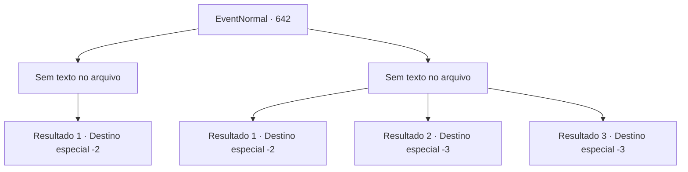

# Eventos normais · 642

[Índice da tabela](index.md) · [Índice geral](../index.md)

ID: `pt:EventNormal:642` · Fonte: `EventNormal4` · Versão: 1.2.47.

Mapeamento estático dos arquivos; a disponibilidade e a execução dependem do estado da run.

## Texto do evento

*Sem texto no arquivo.*

## Dados de entrada

```json
{
  "id": 642,
  "grade": 1,
  "place": "",
  "required": ""
}
```

## Mapa das escolhas



## Escolhas e resultados

### Escolha 1

*Sem texto no arquivo; o papel dessa opção depende da interface do jogo.*

Requisitos e outros campos da escolha:

```json
{
  "required": ""
}
```

#### Resultado 1.1

Você derrota os paladinos, e os guardiões se dispersam e fogem. Agora que ninguém bloqueia seu caminho, você continua caminhando com confiança.

Continuação registrada: [Destino especial `-2`](../destinos-especiais.md).

```json
{
  "required": "",
  "chance": "1",
  "nextEvent": -2,
  "type": 2,
  "reward": "5_845_2"
}
```

### Escolha 2

*Sem texto no arquivo; o papel dessa opção depende da interface do jogo.*

Requisitos e outros campos da escolha:

```json
{
  "required": ""
}
```

#### Resultado 2.1

Você desvia das espadas dos paladinos. Eles te perseguem por um tempo, mas logo desistem da perseguição e voltam para onde estavam.

Continuação registrada: [Destino especial `-2`](../destinos-especiais.md).

```json
{
  "required": "1_0_2|1_1_2",
  "chance": "1",
  "nextEvent": -2,
  "type": 2,
  "reward": "0_0_-1|0_1_-1"
}
```

#### Resultado 2.2

Você é espancado pelos paladinos e cai no chão. Então o inspetor te senta em uma cadeira de madeira e amarra suas mãos e pés. 

 "Aqui. Inale a fumaça deste incensário."

 Ele traz um incensário de latão e despeja a fumaça branca que sai dele sobre você. Você sente sua consciência ficando um pouco turva. Então ele pega um prego de ferro embebido em álcool e perfura seu braço para tirar sangue. Parece que um espeto de ferro quente está te perfurando, mas graças à fumaça, você consegue suportar. Depois de um tempo, quando o sangramento para, o inspetor costura o ferimento e o cauteriza. Seu corpo treme e o suor frio escorre como chuva. E com isso, você perde a consciência.

Continuação registrada: [Destino especial `-3`](../destinos-especiais.md).

```json
{
  "required": "2_0_2",
  "chance": "1",
  "nextEvent": -3,
  "type": 2,
  "reward": "0_0_-1|0_1_-1"
}
```

#### Resultado 2.3

Você é espancado pelos paladinos e cai no chão. Então o inspetor te senta em uma cadeira de madeira e amarra suas mãos e pés. 

 "Aqui. Inale a fumaça deste incensário."

 Ele traz um incensário de latão e despeja a fumaça branca que sai dele sobre você. Você sente sua consciência ficando um pouco turva. Então ele pega um prego de ferro embebido em álcool e perfura seu braço para tirar sangue. Parece que um espeto de ferro quente está te perfurando, mas graças à fumaça, você consegue suportar. Depois de um tempo, quando o sangramento para, o inspetor costura o ferimento e o cauteriza. Seu corpo treme e o suor frio escorre como chuva. E com isso, você perde a consciência.

Continuação registrada: [Destino especial `-3`](../destinos-especiais.md).

```json
{
  "required": "2_1_2",
  "chance": "1",
  "nextEvent": -3,
  "type": 2,
  "reward": "0_0_-1|0_1_-1"
}
```

## Referências que chegam a este evento

- [Evento 641 · escolha 3 · resultado 1](0641.md#escolha-3)
