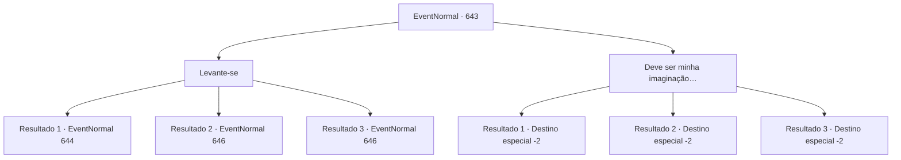

# Eventos normais · 643

[Índice da tabela](index.md) · [Índice geral](../index.md)

ID: `pt:EventNormal:643` · Fonte: `EventNormal4` · Versão: 1.2.47.

Mapeamento estático dos arquivos; a disponibilidade e a execução dependem do estado da run.

## Texto do evento

O crepúsculo carmesim se espalha pelas nuvens baixas. Você reivindica uma clareira à beira da estrada e monta uma barraca, depois estende um cobertor surrado e se deita. O sol rapidamente se esconde atrás das montanhas, e a escuridão se instala no céu.  Com os olhos fechados, você lentamente deriva em direção ao reino do sono. Então, de repente, você sente a presença de alguém por perto.

## Dados de entrada

```json
{
  "id": 643,
  "grade": 1,
  "place": "",
  "required": "5_843_1|5_847_0"
}
```

## Mapa das escolhas



## Escolhas e resultados

### Escolha 1

Levante-se

Requisitos e outros campos da escolha:

```json
{
  "required": ""
}
```

#### Resultado 1.1

Você levanta sua consciência lutadora e se levanta. Então, você encontra o olhar de dois olhos vasculhando sua mochila no escuro. Ele rapidamente se vira e começa a fugir.

Continuação registrada: [Evento 644](0644.md) na mesma tabela.

```json
{
  "required": "",
  "chance": "3",
  "nextEvent": 644,
  "type": 2,
  "reward": "5_847_9"
}
```

#### Resultado 1.2

Você levanta sua consciência lutadora e se levanta. Então, você encontra o olhar de dois olhos vasculhando sua mochila no escuro. A ladra é uma velha maltrapilha, e ela apressadamente enfia algo da sua mochila na boca.

Continuação registrada: [Evento 646](0646.md) na mesma tabela.

```json
{
  "required": "23_0_1",
  "chance": "1",
  "nextEvent": 646,
  "type": 2,
  "reward": "25_0_1|5_847_9"
}
```

#### Resultado 1.3

Você levanta sua consciência lutadora e se levanta. Então, você encontra o olhar de dois olhos vasculhando sua mochila no escuro. A ladra é uma velha maltrapilha, e ela apressadamente enfia algo da sua mochila na boca.

Continuação registrada: [Evento 646](0646.md) na mesma tabela.

```json
{
  "required": "23_10_1",
  "chance": "1",
  "nextEvent": 646,
  "type": 2,
  "reward": "25_10_1|5_847_9"
}
```

### Escolha 2

Deve ser minha imaginação…

Requisitos e outros campos da escolha:

```json
{
  "required": ""
}
```

#### Resultado 2.1

Você acha que não é grande coisa e dorme profundamente. E um pouco depois, a luz do sol te acorda. Sentindo-se incomumente revigorado, você percebe que algo está faltando na sua mochila. Você olha ao redor, mas o ladrão já se foi.

Continuação registrada: [Destino especial `-2`](../destinos-especiais.md).

```json
{
  "required": "23_0_1",
  "chance": "1",
  "nextEvent": -2,
  "type": 2,
  "reward": "0_0_1|0_1_1|25_0_1"
}
```

#### Resultado 2.2

Você acha que não é grande coisa e dorme profundamente. E um pouco depois, a luz do sol te acorda. Sentindo-se incomumente revigorado, você percebe que algo está faltando na sua mochila. Você olha ao redor, mas o ladrão já se foi.

Continuação registrada: [Destino especial `-2`](../destinos-especiais.md).

```json
{
  "required": "23_10_1",
  "chance": "1",
  "nextEvent": -2,
  "type": 2,
  "reward": "0_0_1|0_1_1|25_10_1"
}
```

#### Resultado 2.3

Você acha que não é grande coisa e dorme profundamente. E um pouco depois, a luz do sol te acorda. Sentindo-se incomumente revigorado, você percebe que algo está faltando na sua mochila. Você olha ao redor, mas o ladrão já se foi.

Continuação registrada: [Destino especial `-2`](../destinos-especiais.md).

```json
{
  "required": "24_0_1|24_10_1",
  "chance": "1",
  "nextEvent": -2,
  "type": 2,
  "reward": "0_0_1|0_1_1|0_4_-100"
}
```

## Referências que chegam a este evento

Nenhum `nextEvent` positivo da mesma tabela aponta para este nó. Isso não prova que seja inacessível: sorteio e estado de história podem selecioná-lo.

