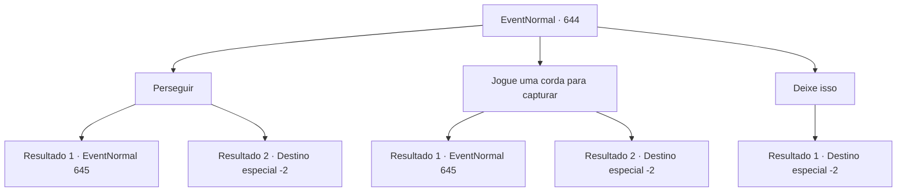

# Eventos normais · 644

[Índice da tabela](index.md) · [Índice geral](../index.md)

ID: `pt:EventNormal:644` · Fonte: `EventNormal4` · Versão: 1.2.47.

Mapeamento estático dos arquivos; a disponibilidade e a execução dependem do estado da run.

## Texto do evento

*Sem texto no arquivo.*

## Dados de entrada

```json
{
  "id": 644,
  "grade": 1,
  "place": "",
  "required": ""
}
```

## Mapa das escolhas



## Escolhas e resultados

### Escolha 1

Perseguir

Requisitos e outros campos da escolha:

```json
{
  "required": ""
}
```

#### Resultado 1.1

Você persegue e pega o ladrão. Um menino pequeno e magro olha para você com olhos assustados. 

 "Oi..oi..! Me desculpe! Por favor, me poupe!!"

 Ele se deita no chão. 

 "Eu fiz isso porque estava com muita, muita fome!"


Continuação registrada: [Evento 645](0645.md) na mesma tabela.

```json
{
  "required": "",
  "chance": "1|0_6_1",
  "nextEvent": 645,
  "type": 0,
  "reward": ""
}
```

#### Resultado 1.2

Você persegue o ladrão, mas ele desaparece na floresta escura e, eventualmente, você perde o ladrão.

Continuação registrada: [Destino especial `-2`](../destinos-especiais.md).

```json
{
  "required": "",
  "chance": "10",
  "nextEvent": -2,
  "type": 1,
  "reward": ""
}
```

### Escolha 2

Jogue uma corda para capturar

Requisitos e outros campos da escolha:

```json
{
  "required": "8_39_1"
}
```

#### Resultado 2.1

Você joga a corda e pega o ladrão. Um menino pequeno e magro olha para você com olhos assustados. 

 "A..Ajuda..! Eu sinto muito! Por favor, me poupe!!"

 Ele se deita no chão. 

 "Eu fiz isso porque estava com muita, muita fome!"


Continuação registrada: [Evento 645](0645.md) na mesma tabela.

```json
{
  "required": "",
  "chance": "1|0_5_1",
  "nextEvent": 645,
  "type": 0,
  "reward": ""
}
```

#### Resultado 2.2

Você joga a corda, mas ela não alcança o ladrão. O ladrão desaparece na floresta escura e, eventualmente, você perde o ladrão.

Continuação registrada: [Destino especial `-2`](../destinos-especiais.md).

```json
{
  "required": "",
  "chance": "5",
  "nextEvent": -2,
  "type": 1,
  "reward": ""
}
```

### Escolha 3

Deixe isso

Requisitos e outros campos da escolha:

```json
{
  "required": ""
}
```

#### Resultado 3.1

Você não se incomoda em perseguir o ladrão porque não perdeu nada. Em vez disso, você fica acordado a noite toda.

Continuação registrada: [Destino especial `-2`](../destinos-especiais.md).

```json
{
  "required": "",
  "chance": "1",
  "nextEvent": -2,
  "type": 2,
  "reward": ""
}
```

## Referências que chegam a este evento

- [Evento 643 · escolha 1 · resultado 1](0643.md#escolha-1)
