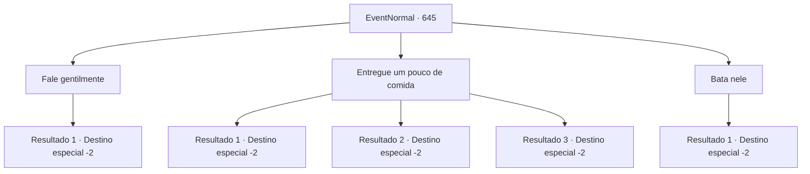

# Eventos normais · 645

[Índice da tabela](index.md) · [Índice geral](../index.md)

ID: `pt:EventNormal:645` · Fonte: `EventNormal4` · Versão: 1.2.47.

Mapeamento estático dos arquivos; a disponibilidade e a execução dependem do estado da run.

## Texto do evento

*Sem texto no arquivo.*

## Dados de entrada

```json
{
  "id": 645,
  "grade": 1,
  "place": "",
  "required": ""
}
```

## Mapa das escolhas



## Escolhas e resultados

### Escolha 1

Fale gentilmente

Requisitos e outros campos da escolha:

```json
{
  "required": ""
}
```

#### Resultado 1.1

Você persuade o menino com palavras gentis e o manda de volta. O menino que estava deitado no chão enxuga as lágrimas e abaixa a cabeça. 

 "Ob... Obrigado! Obrigado!"

 Ele se curva repetidamente para expressar sua gratidão e corre apressadamente.

Continuação registrada: [Destino especial `-2`](../destinos-especiais.md).

```json
{
  "required": "",
  "chance": "1",
  "nextEvent": -2,
  "type": 2,
  "reward": "0_3_1"
}
```

### Escolha 2

Entregue um pouco de comida

Requisitos e outros campos da escolha:

```json
{
  "required": "1_3_0"
}
```

#### Resultado 2.1

Você sente pena do menino e lhe entrega um pouco de comida. O menino, que estava deitado no chão, enxuga as lágrimas e abaixa a cabeça. 

 "O... Obrigado! Obrigado!"

 Ele se curva repetidamente para expressar sua gratidão, apanha a comida apressadamente e corre para algum lugar.

Continuação registrada: [Destino especial `-2`](../destinos-especiais.md).

```json
{
  "required": "23_0_1",
  "chance": "1",
  "nextEvent": -2,
  "type": 2,
  "reward": "25_0_1|5_847_9|0_3_3"
}
```

#### Resultado 2.2

Você sente pena do menino e lhe entrega um pouco de comida. O menino, que estava deitado no chão, enxuga as lágrimas e abaixa a cabeça. 

 "O... Obrigado! Obrigado!"

 Ele se curva repetidamente para expressar sua gratidão, apanha a comida apressadamente e corre para algum lugar.

Continuação registrada: [Destino especial `-2`](../destinos-especiais.md).

```json
{
  "required": "23_10_1",
  "chance": "1",
  "nextEvent": -2,
  "type": 2,
  "reward": "25_10_1|5_847_9|0_3_3"
}
```

#### Resultado 2.3

Você sente pena do menino e tenta dar algo para ele comer, mas não tem nada adequado. Em vez disso, você fala gentilmente com o menino e o manda embora. O menino, que estava deitado no chão, enxuga as lágrimas e abaixa a cabeça. 

 "Ob... Obrigado! Obrigado!"

 Ele se curva repetidamente para expressar sua gratidão e corre embora apressadamente.

Continuação registrada: [Destino especial `-2`](../destinos-especiais.md).

```json
{
  "required": "24_0_1|24_10_1",
  "chance": "1",
  "nextEvent": -2,
  "type": 2,
  "reward": "0_3_1"
}
```

### Escolha 3

Bata nele

Requisitos e outros campos da escolha:

```json
{
  "required": ""
}
```

#### Resultado 3.1

Você é violento com o garoto magro. Ele desmaia e perde a consciência com o seu chute. Ensinando-lhe uma lição de vida, você o deixa e vai para outro lugar.

Continuação registrada: [Destino especial `-2`](../destinos-especiais.md).

```json
{
  "required": "",
  "chance": "1",
  "nextEvent": -2,
  "type": 2,
  "reward": "0_3_-3"
}
```

## Referências que chegam a este evento

- [Evento 644 · escolha 1 · resultado 1](0644.md#escolha-1)
- [Evento 644 · escolha 2 · resultado 1](0644.md#escolha-2)
