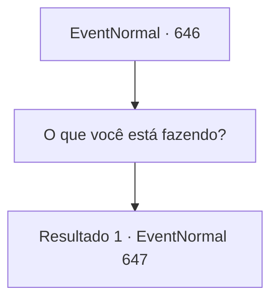

# Eventos normais · 646

[Índice da tabela](index.md) · [Índice geral](../index.md)

ID: `pt:EventNormal:646` · Fonte: `EventNormal4` · Versão: 1.2.47.

Mapeamento estático dos arquivos; a disponibilidade e a execução dependem do estado da run.

## Texto do evento

*Sem texto no arquivo.*

## Dados de entrada

```json
{
  "id": 646,
  "grade": 1,
  "place": "",
  "required": ""
}
```

## Mapa das escolhas



## Escolhas e resultados

### Escolha 1

O que você está fazendo?

Requisitos e outros campos da escolha:

```json
{
  "required": ""
}
```

#### Resultado 1.1

Você se levanta e questiona a velha sobre o que ela está fazendo. Então ela levanta a voz em resposta. 

 "Eu estava com fome, tá bom?! O que diabos você espera? Quando adultos passam fome, fazemos o que queremos! Maldito pirralho... cuide da sua boca!"

 A velha murmura apenas o que quer dizer e vira as costas para você como se quisesse escapar, afastando-se rapidamente.

Continuação registrada: [Evento 647](0647.md) na mesma tabela.

```json
{
  "required": "",
  "chance": "1",
  "nextEvent": 647,
  "type": 2,
  "reward": ""
}
```

## Referências que chegam a este evento

- [Evento 643 · escolha 1 · resultado 2](0643.md#escolha-1)
- [Evento 643 · escolha 1 · resultado 3](0643.md#escolha-1)
