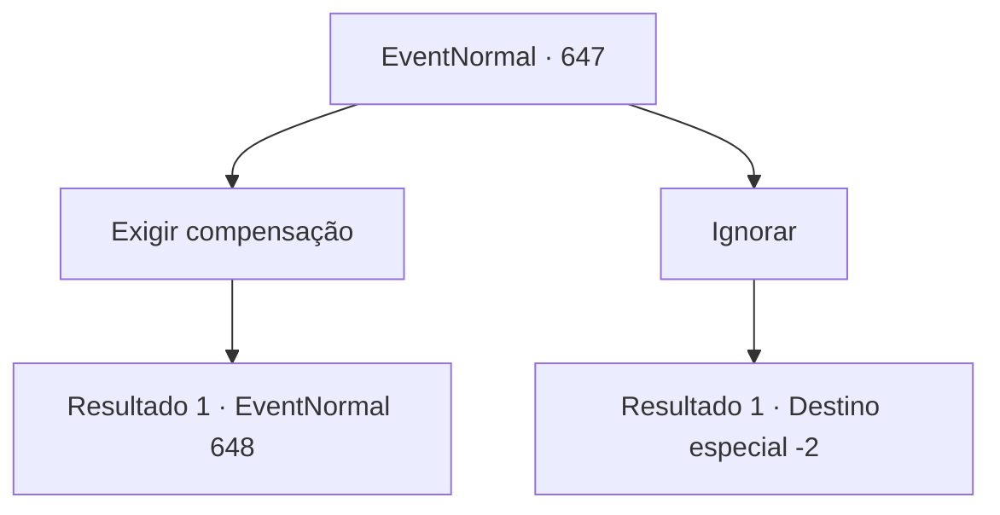

# Eventos normais · 647

[Índice da tabela](index.md) · [Índice geral](../index.md)

ID: `pt:EventNormal:647` · Fonte: `EventNormal4` · Versão: 1.2.47.

Mapeamento estático dos arquivos; a disponibilidade e a execução dependem do estado da run.

## Texto do evento

*Sem texto no arquivo.*

## Dados de entrada

```json
{
  "id": 647,
  "grade": 1,
  "place": "",
  "required": ""
}
```

## Mapa das escolhas



## Escolhas e resultados

### Escolha 1

Exigir compensação

Requisitos e outros campos da escolha:

```json
{
  "required": ""
}
```

#### Resultado 1.1

A velha ouve sua exigência e grita com uma expressão muito rabugenta. 

 "Eu não me importo! Apenas faça o que quiser! Vou morrer em breve de qualquer forma, então faça como quiser!"


Continuação registrada: [Evento 648](0648.md) na mesma tabela.

```json
{
  "required": "",
  "chance": "1",
  "nextEvent": 648,
  "type": 2,
  "reward": ""
}
```

### Escolha 2

Ignorar

Requisitos e outros campos da escolha:

```json
{
  "required": ""
}
```

#### Resultado 2.1

Você decide ignorar a velha. A velha desaparece à distância com um passo triunfante.

Continuação registrada: [Destino especial `-2`](../destinos-especiais.md).

```json
{
  "required": "",
  "chance": "1",
  "nextEvent": -2,
  "type": 2,
  "reward": ""
}
```

## Referências que chegam a este evento

- [Evento 646 · escolha 1 · resultado 1](0646.md#escolha-1)
