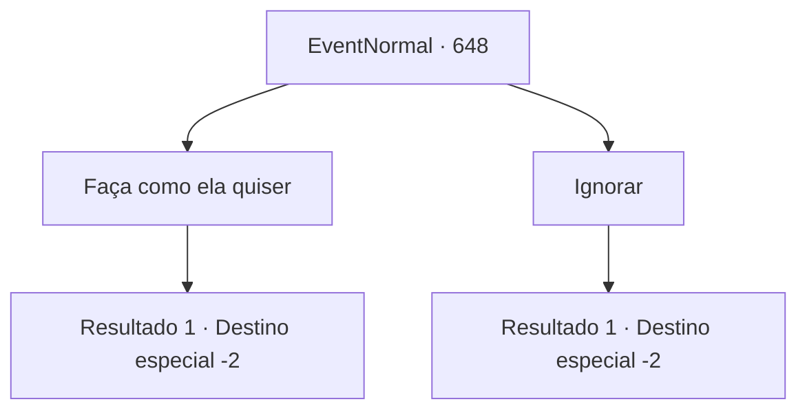

# Eventos normais · 648

[Índice da tabela](index.md) · [Índice geral](../index.md)

ID: `pt:EventNormal:648` · Fonte: `EventNormal4` · Versão: 1.2.47.

Mapeamento estático dos arquivos; a disponibilidade e a execução dependem do estado da run.

## Texto do evento

*Sem texto no arquivo.*

## Dados de entrada

```json
{
  "id": 648,
  "grade": 1,
  "place": "",
  "required": ""
}
```

## Mapa das escolhas



## Escolhas e resultados

### Escolha 1

Faça como ela quiser

Requisitos e outros campos da escolha:

```json
{
  "required": "2_3_0"
}
```

#### Resultado 1.1

Você não segura sua raiva e decide fazer o que ela quer. A velha desaba com um único soco seu e parte para um lugar de onde não pode voltar. Embora você não possa fazer nada sobre a comida que a velha comeu, pelo menos pode extravasar sua raiva.

Continuação registrada: [Destino especial `-2`](../destinos-especiais.md).

```json
{
  "required": "",
  "chance": "1",
  "nextEvent": -2,
  "type": 2,
  "reward": "0_1_1"
}
```

### Escolha 2

Ignorar

Requisitos e outros campos da escolha:

```json
{
  "required": ""
}
```

#### Resultado 2.1

Você decide ignorar a velha. A velha desaparece à distância com um passo triunfante.

Continuação registrada: [Destino especial `-2`](../destinos-especiais.md).

```json
{
  "required": "",
  "chance": "1",
  "nextEvent": -2,
  "type": 2,
  "reward": ""
}
```

## Referências que chegam a este evento

- [Evento 647 · escolha 1 · resultado 1](0647.md#escolha-1)
