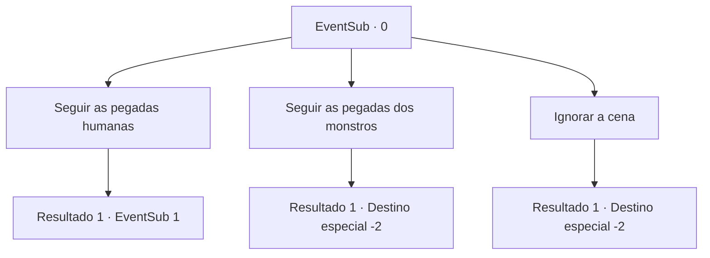

# Eventos secundários · 0

[Índice da tabela](index.md) · [Índice geral](../index.md)

ID: `pt:EventSub:0` · Fonte: `EventSub4` · Versão: 1.2.47.

Mapeamento estático dos arquivos; a disponibilidade e a execução dependem do estado da run.

## Texto do evento

Você passa por uma carruagem quebrada cercada por alguns poucos cadáveres mutilados de cavalos e soldados armados mortos.|drawing_deadBodies|Você cuidadosamente analisa a cena e encontra diversas pegadas de monstros e de humanos. Uma das trilhas sugere que alguém fugiu.

## Dados de entrada

```json
{
  "id": 0,
  "grade": 1,
  "subEvent": "0",
  "required": "12_0_0"
}
```

## Mapa das escolhas



## Escolhas e resultados

### Escolha 1

Seguir as pegadas humanas

Requisitos e outros campos da escolha:

```json
{
  "required": ""
}
```

#### Resultado 1.1

O solo está lamacento, então investigar as pegadas é fácil. Você logo encontra a fugitiva. Ela para de bater suas correntes contra uma rocha e olha para você, surpresa.

Continuação registrada: [Evento 1](0001.md) na mesma tabela.

```json
{
  "required": "",
  "chance": "1",
  "nextEvent": 1,
  "type": 2,
  "reward": ""
}
```

### Escolha 2

Seguir as pegadas dos monstros

Requisitos e outros campos da escolha:

```json
{
  "required": ""
}
```

#### Resultado 2.1

Você examina as pegadas, concluindo que elas pertencem um Serpe. Seus rastros levam ao norte, mas não por muito tempo. Supondo que ele tenha causado os destroços, você continua a rastrear a fera mesmo assim.

Continuação registrada: [Destino especial `-2`](../destinos-especiais.md).

```json
{
  "required": "",
  "chance": "1",
  "nextEvent": -2,
  "type": 2,
  "reward": "12_0_1"
}
```

### Escolha 3

Ignorar a cena

Requisitos e outros campos da escolha:

```json
{
  "required": ""
}
```

#### Resultado 3.1

Você decide que é melhor não interferir e se retira.

Continuação registrada: [Destino especial `-2`](../destinos-especiais.md).

```json
{
  "required": "",
  "chance": "1",
  "nextEvent": -2,
  "type": 2,
  "reward": "12_0_-1"
}
```

## Referências que chegam a este evento

Nenhum `nextEvent` positivo da mesma tabela aponta para este nó. Isso não prova que seja inacessível: sorteio e estado de história podem selecioná-lo.

