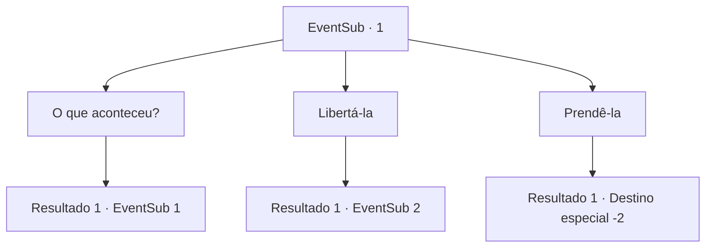

# Eventos secundários · 1

[Índice da tabela](index.md) · [Índice geral](../index.md)

ID: `pt:EventSub:1` · Fonte: `EventSub4` · Versão: 1.2.47.

Mapeamento estático dos arquivos; a disponibilidade e a execução dependem do estado da run.

## Texto do evento

*Sem texto no arquivo.*

## Dados de entrada

```json
{
  "id": 1,
  "grade": 1,
  "subEvent": "0",
  "required": ""
}
```

## Mapa das escolhas



## Escolhas e resultados

### Escolha 1

O que aconteceu?

Requisitos e outros campos da escolha:

```json
{
  "required": "5_17_0"
}
```

#### Resultado 1.1

Ela senta em uma das rochas e conta a história dela. Ela é uma caçadora que costumava morar perto da fronteira, e estava tendo problemas com a patrulha de fronteira por causa das áreas de caça. Um dia, a patrulha de fronteira prendeu ela após uma discussão acalorada. Ela conseguiu escapar graças à emboscada do Serpe. 

 "Hmph! Aqueles desgraçados mereceram. Quem são eles para me dizer onde caçar?"


Continuação registrada: [Evento 1](0001.md) na mesma tabela.

```json
{
  "required": "",
  "chance": "1",
  "nextEvent": 1,
  "type": 2,
  "reward": "5_17_1"
}
```

### Escolha 2

Libertá-la

Requisitos e outros campos da escolha:

```json
{
  "required": ""
}
```

#### Resultado 2.1

Você ajuda ela com as algemas. Ela agradece e pede que você a siga para receber uma recompensa. O nome dela era Majet, e ela conduz você por uma montanha até uma pequena cabana. Mas não sobrou muito da cabana.|drawing_wybern|

 "Grrrr..."

 O Serpe surge das ruínas da cabana como se estivesse esperando. 

 "Sua desgraçada... Essa é a minha casa..."

 Berrando, a Serpe avança em direção a vocês dois.

Continuação registrada: [Evento 2](0002.md) na mesma tabela.

```json
{
  "required": "",
  "chance": "1",
  "nextEvent": 2,
  "type": 2,
  "reward": "12_0_2|6_0_40",
  "place": 1
}
```

### Escolha 3

Prendê-la

Requisitos e outros campos da escolha:

```json
{
  "required": ""
}
```

#### Resultado 3.1

Você aperta as correntes que a prendem. Ela torce e gira, mas você consegue levá-la para um posto da patrulha de fronteira. 
 Um guarda te aborda desconfiado, na medida em que você se aproxima. Ele vê a caçadora amarrada, paga você em ouro e a leva.

Continuação registrada: [Destino especial `-2`](../destinos-especiais.md).

```json
{
  "required": "",
  "chance": "1",
  "nextEvent": -2,
  "type": 2,
  "reward": "0_4_20|12_0_3|0_2_2"
}
```

## Referências que chegam a este evento

- [Evento 0 · escolha 1 · resultado 1](0000.md#escolha-1)
- [Evento 1 · escolha 1 · resultado 1](0001.md#escolha-1)
