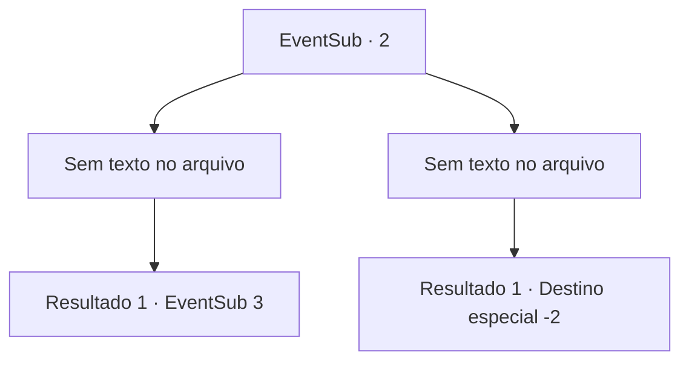

# Eventos secundários · 2

[Índice da tabela](index.md) · [Índice geral](../index.md)

ID: `pt:EventSub:2` · Fonte: `EventSub4` · Versão: 1.2.47.

Mapeamento estático dos arquivos; a disponibilidade e a execução dependem do estado da run.

## Texto do evento

*Sem texto no arquivo.*

## Dados de entrada

```json
{
  "id": 2,
  "grade": 1,
  "subEvent": "0",
  "required": "12_0_2"
}
```

## Mapa das escolhas



## Escolhas e resultados

### Escolha 1

*Sem texto no arquivo; o papel dessa opção depende da interface do jogo.*

Requisitos e outros campos da escolha:

```json
{
  "required": ""
}
```

#### Resultado 1.1

Você desfere seu golpe final, e o Serpe desaba, cuspindo sangue. A caçadora começa a esfolar o cadáver do Serpe com uma pequena adaga.

Continuação registrada: [Evento 3](0003.md) na mesma tabela.

```json
{
  "required": "",
  "chance": "1",
  "nextEvent": 3,
  "type": 2,
  "reward": ""
}
```

### Escolha 2

*Sem texto no arquivo; o papel dessa opção depende da interface do jogo.*

Requisitos e outros campos da escolha:

```json
{
  "required": ""
}
```

#### Resultado 2.1

A última coisa que você vê é o rosto do Serpe vindo em sua direção. Você acorda dentro de uma tenda surrada. Você sente uma imensa dor no estômago ao sair da tenda, e encontra a caçadora. 

 "Peço desculpas por te envolver em tudo isso... A Serpe foi, assim como a minha casa, mas eu irei te retribuir mais tarde. Eu prometo."

 E com isso, Majet vai embora.

Continuação registrada: [Destino especial `-2`](../destinos-especiais.md).

```json
{
  "required": "",
  "chance": "1",
  "nextEvent": -2,
  "type": 2,
  "reward": "12_0_4"
}
```

## Referências que chegam a este evento

- [Evento 1 · escolha 2 · resultado 1](0001.md#escolha-2)
