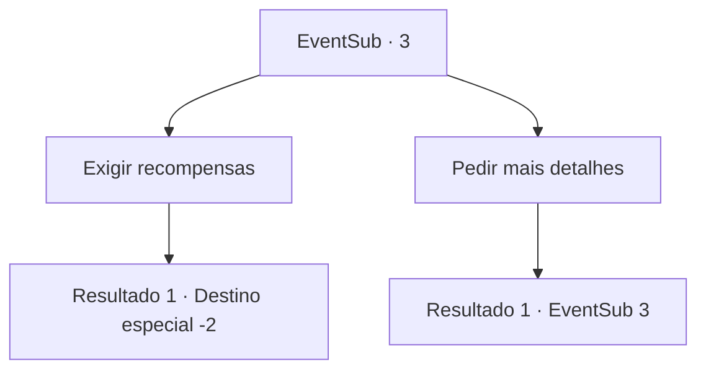

# Eventos secundários · 3

[Índice da tabela](index.md) · [Índice geral](../index.md)

ID: `pt:EventSub:3` · Fonte: `EventSub4` · Versão: 1.2.47.

Mapeamento estático dos arquivos; a disponibilidade e a execução dependem do estado da run.

## Texto do evento

*Sem texto no arquivo.*

## Dados de entrada

```json
{
  "id": 3,
  "grade": 1,
  "subEvent": "0",
  "required": ""
}
```

## Mapa das escolhas



## Escolhas e resultados

### Escolha 1

Exigir recompensas

Requisitos e outros campos da escolha:

```json
{
  "required": ""
}
```

#### Resultado 1.1


 "Sua recompensa está bem aqui. Que tal uma ajudinha?"

 Ela diz isso ao mesmo tempo em que enfia a faca no corpo do Serpe. Você ajuda ela a tirar o couro e separar os ossos.  Depois de terminar, ela lhe entrega uma orbe do tamanho de um punho. A orbe brilha em vermelho através das manchas de sangue do Serpe. 

 "Isso vale mais do que o couro e os chifres. De qualquer maneira... Obrigado pela ajuda."

 Você pega a essência do Serpe e se despede da caçadora.

Continuação registrada: [Destino especial `-2`](../destinos-especiais.md).

```json
{
  "required": "",
  "chance": "1",
  "nextEvent": -2,
  "type": 2,
  "reward": "3_45_1|12_0_4|0_2_2"
}
```

### Escolha 2

Pedir mais detalhes

Requisitos e outros campos da escolha:

```json
{
  "required": "5_12_0"
}
```

#### Resultado 2.1

Majet lhe responde enquanto esfola o animal. Ela caçou um Serpe macho recentemente, tendo ignorado completamente a possível existência de uma fêmea.  A fêmea vingativa enboscou um grupo de humanos que presumiu serem os responsáveis, e encontrou o assassino.

Continuação registrada: [Evento 3](0003.md) na mesma tabela.

```json
{
  "required": "",
  "chance": "1",
  "nextEvent": 3,
  "type": 2,
  "reward": "5_12_1"
}
```

## Referências que chegam a este evento

- [Evento 2 · escolha 1 · resultado 1](0002.md#escolha-1)
- [Evento 3 · escolha 2 · resultado 1](0003.md#escolha-2)
