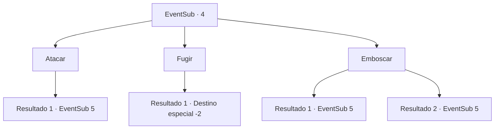

# Eventos secundários · 4

[Índice da tabela](index.md) · [Índice geral](../index.md)

ID: `pt:EventSub:4` · Fonte: `EventSub4` · Versão: 1.2.47.

Mapeamento estático dos arquivos; a disponibilidade e a execução dependem do estado da run.

## Texto do evento

Você vai na direção que presume que a Serpe tomou. Logo, você sente o cheiro de sangue e ácido através das árvores. Você encontra a Serpe mastigando alguma coisa, em cima dos restos de uma cabana que ela destruiu. Ela não nota a sua presença. Você ouve o último grito rouco de alguém que estava sendo atacado por ela.

## Dados de entrada

```json
{
  "id": 4,
  "grade": 1,
  "subEvent": "0",
  "required": "12_0_1"
}
```

## Mapa das escolhas



## Escolhas e resultados

### Escolha 1

Atacar

Requisitos e outros campos da escolha:

```json
{
  "required": ""
}
```

#### Resultado 1.1

Você avança contra o serpe enquanto grita. Ele ergue os olhos, surpreso. Então ele abre suas mandíbulas e grita. 

 "SKHREEEE!"


Continuação registrada: [Evento 5](0005.md) na mesma tabela.

```json
{
  "required": "",
  "chance": "1",
  "nextEvent": 5,
  "type": 2,
  "reward": "6_0_40",
  "place": 1
}
```

### Escolha 2

Fugir

Requisitos e outros campos da escolha:

```json
{
  "required": ""
}
```

#### Resultado 2.1

Você deixa o serpe saborear a refeição dele e sai silenciosamente.

Continuação registrada: [Destino especial `-2`](../destinos-especiais.md).

```json
{
  "required": "",
  "chance": "1",
  "nextEvent": -2,
  "type": 2,
  "reward": "12_0_-1"
}
```

### Escolha 3

Emboscar

Requisitos e outros campos da escolha:

```json
{
  "required": ""
}
```

#### Resultado 3.1

Você tenta se esgueirar por trás do serpe, mas pisa em um galho. A criatura vira a cabeça e vê você.

Continuação registrada: [Evento 5](0005.md) na mesma tabela.

```json
{
  "required": "",
  "chance": "15",
  "nextEvent": 5,
  "type": 1,
  "reward": "6_0_40",
  "place": 1
}
```

#### Resultado 3.2

Você se esgueira por trás do serpe e monta nele. Você puxa sua arma e a mergulha profundamente no corpo dele.

Continuação registrada: [Evento 5](0005.md) na mesma tabela.

```json
{
  "required": "",
  "chance": "1|0_6_1",
  "nextEvent": 5,
  "type": 0,
  "reward": "6_2_40",
  "place": 1
}
```

## Referências que chegam a este evento

Nenhum `nextEvent` positivo da mesma tabela aponta para este nó. Isso não prova que seja inacessível: sorteio e estado de história podem selecioná-lo.

