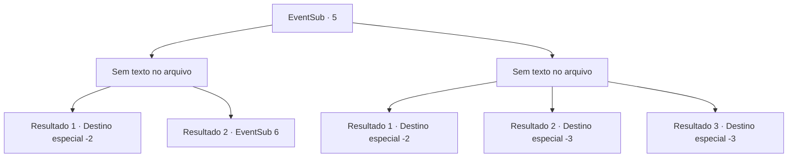

# Eventos secundários · 5

[Índice da tabela](index.md) · [Índice geral](../index.md)

ID: `pt:EventSub:5` · Fonte: `EventSub4` · Versão: 1.2.47.

Mapeamento estático dos arquivos; a disponibilidade e a execução dependem do estado da run.

## Texto do evento

*Sem texto no arquivo.*

## Dados de entrada

```json
{
  "id": 5,
  "grade": 1,
  "subEvent": "0",
  "required": ""
}
```

## Mapa das escolhas



## Escolhas e resultados

### Escolha 1

*Sem texto no arquivo; o papel dessa opção depende da interface do jogo.*

Requisitos e outros campos da escolha:

```json
{
  "required": ""
}
```

#### Resultado 1.1

O serpe luta ferozmente, mas eventualmente cai por suas mãos. Ele vomita toda a carne que comia ao entrar em colapso. Você encontra a vítima comida pelo serpe, mas ela já está morta.

Continuação registrada: [Destino especial `-2`](../destinos-especiais.md).

```json
{
  "required": "",
  "chance": "1",
  "nextEvent": -2,
  "type": 2,
  "reward": "12_0_-1|0_2_2|0_1_-1"
}
```

#### Resultado 1.2

O serpe luta ferozmente, mas eventualmente cai em suas mãos. Ele vomita toda a carne que comia ao entrar em colapso. Você encontra a vítima cujo gemido você ouviu. Ela está quase morta.

Continuação registrada: [Evento 6](0006.md) na mesma tabela.

```json
{
  "required": "",
  "chance": "3",
  "nextEvent": 6,
  "type": 2,
  "reward": ""
}
```

### Escolha 2

*Sem texto no arquivo; o papel dessa opção depende da interface do jogo.*

Requisitos e outros campos da escolha:

```json
{
  "required": ""
}
```

#### Resultado 2.1

O serpe o atinge com a cauda e você desmaia. Quando você volta aos seus sentidos, ele não está em lugar nenhum. Você teve sorte dele não estar com muita fome.

Continuação registrada: [Destino especial `-2`](../destinos-especiais.md).

```json
{
  "required": "1_0_2|1_1_2",
  "chance": "1",
  "nextEvent": -2,
  "type": 2,
  "reward": "0_0_-1|0_1_-1|12_0_-1|0_2_2"
}
```

#### Resultado 2.2

O serpe o atinge com a cauda e você desmaia. Você nunca mais acorda.

Continuação registrada: [Destino especial `-3`](../destinos-especiais.md).

```json
{
  "required": "2_0_2",
  "chance": "1",
  "nextEvent": -3,
  "type": 2,
  "reward": "0_0_-1|0_1_-1"
}
```

#### Resultado 2.3

O serpe o atinge com a cauda e você desmaia. Você nunca mais acorda.

Continuação registrada: [Destino especial `-3`](../destinos-especiais.md).

```json
{
  "required": "2_1_2",
  "chance": "1",
  "nextEvent": -3,
  "type": 2,
  "reward": "0_0_-1|0_1_-1"
}
```

## Referências que chegam a este evento

- [Evento 4 · escolha 1 · resultado 1](0004.md#escolha-1)
- [Evento 4 · escolha 3 · resultado 1](0004.md#escolha-3)
- [Evento 4 · escolha 3 · resultado 2](0004.md#escolha-3)
