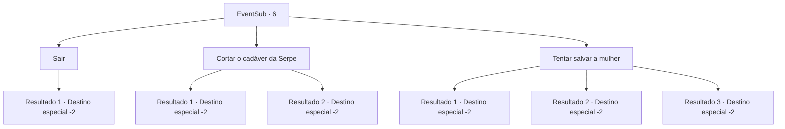

# Eventos secundários · 6

[Índice da tabela](index.md) · [Índice geral](../index.md)

ID: `pt:EventSub:6` · Fonte: `EventSub4` · Versão: 1.2.47.

Mapeamento estático dos arquivos; a disponibilidade e a execução dependem do estado da run.

## Texto do evento

*Sem texto no arquivo.*

## Dados de entrada

```json
{
  "id": 6,
  "grade": 1,
  "subEvent": "0",
  "required": ""
}
```

## Mapa das escolhas



## Escolhas e resultados

### Escolha 1

Sair

Requisitos e outros campos da escolha:

```json
{
  "required": ""
}
```

#### Resultado 1.1

Você deixa o serpe e a caçadora mortos para trás, e segue em frente.

Continuação registrada: [Destino especial `-2`](../destinos-especiais.md).

```json
{
  "required": "",
  "chance": "1",
  "nextEvent": -2,
  "type": 2,
  "reward": "12_0_-1"
}
```

### Escolha 2

Cortar o cadáver da Serpe

Requisitos e outros campos da escolha:

```json
{
  "required": ""
}
```

#### Resultado 2.1

Você tenta cortar o corpo do serpe em busca de partes úteis, mas isso não dá certo. A mulher morre enquanto você perde tempo com os ossos e a carne da criatura. Você não tem nada a ganhar, então você deixa o corpo para trás e segue para outro lugar.

Continuação registrada: [Destino especial `-2`](../destinos-especiais.md).

```json
{
  "required": "",
  "chance": "10",
  "nextEvent": -2,
  "type": 2,
  "reward": "0_2_2|0_3_-3|12_0_-1"
}
```

#### Resultado 2.2

Você corta o corpo do serpe. O couro é muito danificado para ser utilizado, e os ossos são muito pesados para serem carregados, então você só carrega sua essência.  A mulher morre enquanto você perde tempo com os ossos e a carne da criatura. Você não tem nada a ganhar, então você deixa o corpo para trás e segue para outro lugar.

Continuação registrada: [Destino especial `-2`](../destinos-especiais.md).

```json
{
  "required": "",
  "chance": "1|0_5_1",
  "nextEvent": -2,
  "type": 2,
  "reward": "3_45_1|0_2_2|12_0_-1"
}
```

### Escolha 3

Tentar salvar a mulher

Requisitos e outros campos da escolha:

```json
{
  "required": "1_3_0"
}
```

#### Resultado 3.1

Você tenta salvar a mulher inconsciente, mas falha.

Continuação registrada: [Destino especial `-2`](../destinos-especiais.md).

```json
{
  "required": "24_6_1",
  "chance": "12",
  "nextEvent": -2,
  "type": 1,
  "reward": "12_0_-1|0_1_-1|0_3_1"
}
```

#### Resultado 3.2

Você trata as feridas á medida do possível. 

 Leva um tempo até ela recuperar a consciência. Ela diz que lhe deve a vida, e e que um dia irá lhe recompensar. 

 "Me chamo Majet. Não posso oferecer muito, visto o estado da casa e da minha saúde, mas lembrarei da minha dívida"

 Dito isso, vocês seguem seus caminhos distintos.

Continuação registrada: [Destino especial `-2`](../destinos-especiais.md).

```json
{
  "required": "24_6_1",
  "chance": "1|0_7_1",
  "nextEvent": -2,
  "type": 0,
  "reward": "0_3_10|0_2_2|12_0_4"
}
```

#### Resultado 3.3

Você a trata com a poção que tem. 

  Leva um tempo até ela recuperar a consciência.  Ela diz que lhe deve a vida, e e que um dia irá lhe recompensar.  

 "Me chamo Majet. Não posso oferecer muito, visto o estado da casa e da minha saúde, mas lembrarei da minha dívida"

  Dito isso, vocês seguem seus caminhos distintos.

Continuação registrada: [Destino especial `-2`](../destinos-especiais.md).

```json
{
  "required": "23_6_1",
  "chance": "1",
  "nextEvent": -2,
  "type": 2,
  "reward": "0_3_10|0_2_2|12_0_4|25_6_1"
}
```

## Referências que chegam a este evento

- [Evento 5 · escolha 1 · resultado 2](0005.md#escolha-1)
