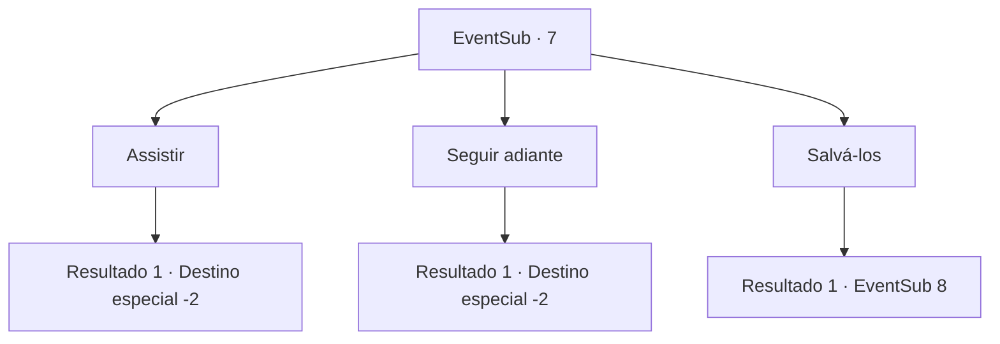

# Eventos secundários · 7

[Índice da tabela](index.md) · [Índice geral](../index.md)

ID: `pt:EventSub:7` · Fonte: `EventSub4` · Versão: 1.2.47.

Mapeamento estático dos arquivos; a disponibilidade e a execução dependem do estado da run.

## Texto do evento

Guardas estão montando forcas na periferia da cidade. Um homem de armadura desdobra um documento feito de pele de carneiro e anuncia a condenada e o crime dela. 

 "...Nome, Majet. Culpada de espionagem além das fronteiras. Sentenciada ao enforcamento com os outros três."

 A mulher chamada Majet é aquela que você prendeu e entregou. Os rostos dos condenados estão machucados e inchados, dificultando o reconhecimento de cada um deles. Um guarda cobre os rostos deles com panos pretos.

## Dados de entrada

```json
{
  "id": 7,
  "grade": 1,
  "subEvent": "0",
  "required": "12_0_3"
}
```

## Mapa das escolhas



## Escolhas e resultados

### Escolha 1

Assistir

Requisitos e outros campos da escolha:

```json
{
  "required": ""
}
```

#### Resultado 1.1

|drawing_hang|O chão abaixo de seus pés se abre.  Os quatro condenados se debatem um pouco antes de endurecerem.  Alguns comemoram.  Você se retirou da multidão e prossegiu.

Continuação registrada: [Destino especial `-2`](../destinos-especiais.md).

```json
{
  "required": "",
  "chance": "1",
  "nextEvent": -2,
  "type": 2,
  "reward": "12_0_-1"
}
```

### Escolha 2

Seguir adiante

Requisitos e outros campos da escolha:

```json
{
  "required": ""
}
```

#### Resultado 2.1

Você se afasta da forca. Você ouve o chão se abrir enquanto as pessoas comemoram.

Continuação registrada: [Destino especial `-2`](../destinos-especiais.md).

```json
{
  "required": "",
  "chance": "1",
  "nextEvent": -2,
  "type": 2,
  "reward": "12_0_-1"
}
```

### Escolha 3

Salvá-los

Requisitos e outros campos da escolha:

```json
{
  "required": ""
}
```

#### Resultado 3.1

Você pula na forca antes que alguém possa impedí-lo. Você corta todas as cordas em um instante. Surpresos, os guardas sacam suas armas ás pressas

Continuação registrada: [Evento 8](0008.md) na mesma tabela.

```json
{
  "required": "",
  "chance": "1",
  "nextEvent": 8,
  "type": 2,
  "reward": "6_0_21",
  "place": 4
}
```

## Referências que chegam a este evento

Nenhum `nextEvent` positivo da mesma tabela aponta para este nó. Isso não prova que seja inacessível: sorteio e estado de história podem selecioná-lo.

