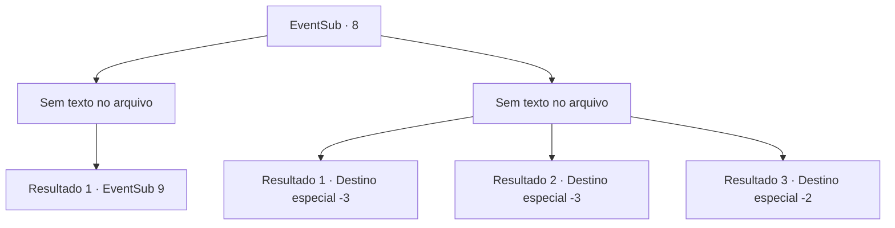

# Eventos secundários · 8

[Índice da tabela](index.md) · [Índice geral](../index.md)

ID: `pt:EventSub:8` · Fonte: `EventSub4` · Versão: 1.2.47.

Mapeamento estático dos arquivos; a disponibilidade e a execução dependem do estado da run.

## Texto do evento

*Sem texto no arquivo.*

## Dados de entrada

```json
{
  "id": 8,
  "grade": 1,
  "subEvent": "0",
  "required": ""
}
```

## Mapa das escolhas



## Escolhas e resultados

### Escolha 1

*Sem texto no arquivo; o papel dessa opção depende da interface do jogo.*

Requisitos e outros campos da escolha:

```json
{
  "required": ""
}
```

#### Resultado 1.1

Os condenados somem enquanto você derrota os guardas. Todos exceto Majet, a caçadora que você lhes entregou pessoalmente. Ela lhe toma pelo braço e lhe leva para bem longe. Assim que a cidade some de vista, ela pergunta por que você a salvou.

Continuação registrada: [Evento 9](0009.md) na mesma tabela.

```json
{
  "required": "",
  "chance": "1",
  "nextEvent": 9,
  "type": 2,
  "reward": ""
}
```

### Escolha 2

*Sem texto no arquivo; o papel dessa opção depende da interface do jogo.*

Requisitos e outros campos da escolha:

```json
{
  "required": ""
}
```

#### Resultado 2.1

Os guardas te derrotam e te penduram junto com os outros.

Continuação registrada: [Destino especial `-3`](../destinos-especiais.md).

```json
{
  "required": "2_0_2",
  "chance": "1",
  "nextEvent": -3,
  "type": 2,
  "reward": "0_0_-1|0_1_-1"
}
```

#### Resultado 2.2

Os guardas te derrotam e te penduram junto com os outros.

Continuação registrada: [Destino especial `-3`](../destinos-especiais.md).

```json
{
  "required": "2_1_2",
  "chance": "1",
  "nextEvent": -3,
  "type": 2,
  "reward": "0_0_-1|0_1_-1"
}
```

#### Resultado 2.3

Você apenas se afasta dos guardas. Os condenados escapam enquanto você luta contra os guardas.

Continuação registrada: [Destino especial `-2`](../destinos-especiais.md).

```json
{
  "required": "1_0_2|1_1_2",
  "chance": "1",
  "nextEvent": -2,
  "type": 2,
  "reward": "0_0_-1|0_1_-1|12_0_-1|0_2_1"
}
```

## Referências que chegam a este evento

- [Evento 7 · escolha 3 · resultado 1](0007.md#escolha-3)
