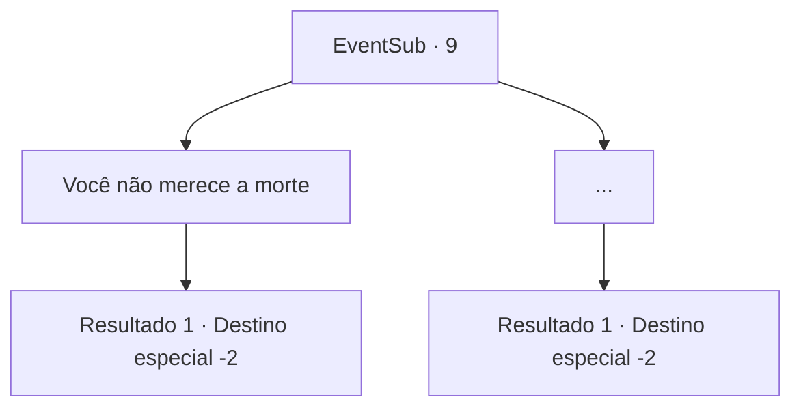

# Eventos secundários · 9

[Índice da tabela](index.md) · [Índice geral](../index.md)

ID: `pt:EventSub:9` · Fonte: `EventSub4` · Versão: 1.2.47.

Mapeamento estático dos arquivos; a disponibilidade e a execução dependem do estado da run.

## Texto do evento

*Sem texto no arquivo.*

## Dados de entrada

```json
{
  "id": 9,
  "grade": 1,
  "subEvent": "0",
  "required": ""
}
```

## Mapa das escolhas



## Escolhas e resultados

### Escolha 1

Você não merece a morte 

Requisitos e outros campos da escolha:

```json
{
  "required": ""
}
```

#### Resultado 1.1

Ela reage indignada. 

 "Pra começo de conversa, se você não tivesse me entregado...! Ai..."

 Ela para pra pôr a mão sobre o queixo. Após massageá-lo de leve, ela continua. 

 "Enfim... Você salvou minha vida. Mas não sei se deveria lhe agradecer..."

 Ela lhe encara e se retira.

Continuação registrada: [Destino especial `-2`](../destinos-especiais.md).

```json
{
  "required": "",
  "chance": "1",
  "nextEvent": -2,
  "type": 2,
  "reward": "0_2_2|5_9_1|12_0_4|5_91_1"
}
```

### Escolha 2

...

Requisitos e outros campos da escolha:

```json
{
  "required": ""
}
```

#### Resultado 2.1

Há um momento de desconfortável silêncio. Ela lhe encara e vai embora.

Continuação registrada: [Destino especial `-2`](../destinos-especiais.md).

```json
{
  "required": "",
  "chance": "1",
  "nextEvent": -2,
  "type": 2,
  "reward": "0_2_2|5_9_1|12_0_-1"
}
```

## Referências que chegam a este evento

- [Evento 8 · escolha 1 · resultado 1](0008.md#escolha-1)
