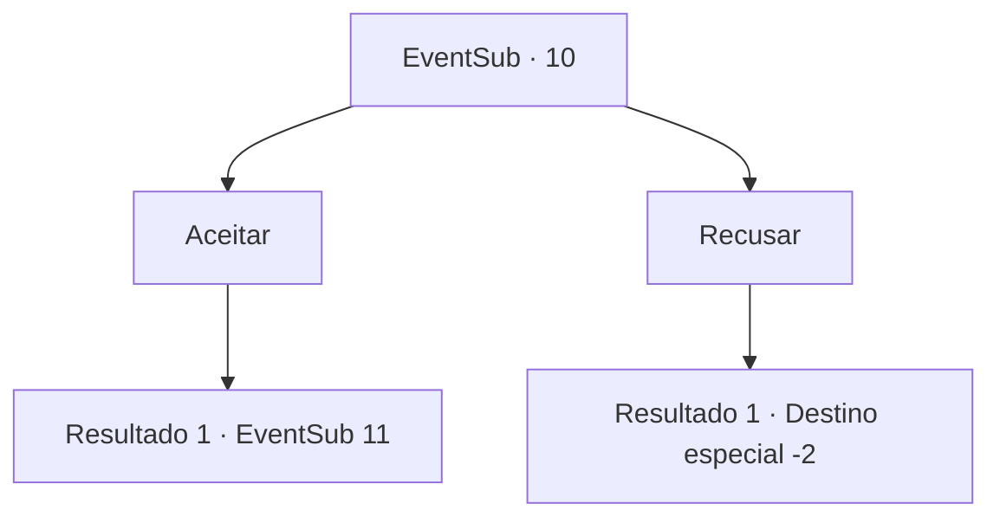

# Eventos secundários · 10

[Índice da tabela](index.md) · [Índice geral](../index.md)

ID: `pt:EventSub:10` · Fonte: `EventSub4` · Versão: 1.2.47.

Mapeamento estático dos arquivos; a disponibilidade e a execução dependem do estado da run.

## Texto do evento

|drawing_camp|A escuridão cobre os campos silenciosos. De repente, alguém tosse atrás de você. É Majet, de antes. 

 "Tenho algumas informações úteis para retribuir. Ouça."

 Majet conta rumores sobre a Mulher Aranha. Ela conta sobre a Mulher Aranha, aquela que, segundo os rumores, seduz e devora os homens que viajam por sua floresta. 

 "O que acha de me ajudar nessa caçada?"


## Dados de entrada

```json
{
  "id": 10,
  "grade": 1,
  "subEvent": "0",
  "required": "12_0_4"
}
```

## Mapa das escolhas



## Escolhas e resultados

### Escolha 1

Aceitar

Requisitos e outros campos da escolha:

```json
{
  "required": ""
}
```

#### Resultado 1.1


 "Encontrei alguém que viu a Mulher Aranha na íntegra. Seu nome é Anna."

 Juntos, vocês vão para Odtun, a pequena cidade onde mora a Anna. A casinha dela fica ás margens da cidade Uma mulher abatida surge e olha para Majet e você. 

 "Quem... são vocês?"

 Você pergunta a ela sobra a Mulher Aranha. A mulher assoa e convida vocês dois a entrarem. Ela soluça em pranto desde o começo. 

 "Já fazem vários dias desde que o Johnny desapareceu. Deve ser aquela Aranha, eu sei disso..."

 Ela começa a chorar alto, com os ombros tremendo.

Continuação registrada: [Evento 11](0011.md) na mesma tabela.

```json
{
  "required": "",
  "chance": "1",
  "nextEvent": 11,
  "type": 2,
  "reward": ""
}
```

### Escolha 2

Recusar

Requisitos e outros campos da escolha:

```json
{
  "required": ""
}
```

#### Resultado 2.1

Você rejeita a oferta de Majet. Ela diz que você está perdendo e vai embora.

Continuação registrada: [Destino especial `-2`](../destinos-especiais.md).

```json
{
  "required": "",
  "chance": "1",
  "nextEvent": -2,
  "type": 2,
  "reward": "12_0_-1"
}
```

## Referências que chegam a este evento

Nenhum `nextEvent` positivo da mesma tabela aponta para este nó. Isso não prova que seja inacessível: sorteio e estado de história podem selecioná-lo.

