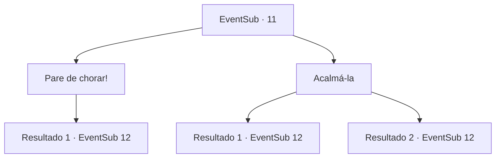

# Eventos secundários · 11

[Índice da tabela](index.md) · [Índice geral](../index.md)

ID: `pt:EventSub:11` · Fonte: `EventSub4` · Versão: 1.2.47.

Mapeamento estático dos arquivos; a disponibilidade e a execução dependem do estado da run.

## Texto do evento

*Sem texto no arquivo.*

## Dados de entrada

```json
{
  "id": 11,
  "grade": 1,
  "subEvent": "0",
  "required": ""
}
```

## Mapa das escolhas



## Escolhas e resultados

### Escolha 1

Pare de chorar!

Requisitos e outros campos da escolha:

```json
{
  "required": ""
}
```

#### Resultado 1.1

Você manda a Anna parar de chorar e falar direito. Ela chora mias ainda. 

 "Ugh... Nos dê um tempinho"

 Majet força a sua saída. Ela depois repassa o que ouviu da Anna. 

 Segundo Anna, seu amor, Johnny, visitava com frequência a Floresta das Aranhas até pouco tempo. Anna afirma ter visto uma bela mulher virar uma aranha gigante quando foi á floresta ver Johnny. Você e Majet decidem investigar a Floresta das Aranhas. 

 Após um longo trajeto, vocês finalmente chegam na Floresta das Aranhas. Com árvores altas e densas, ela é negra como a noite, mesmo sob a luz do dia. Você adentra nas sombras, até Majet lhe parar de repente com sua mão. Ela então atira uma flecha no chão. 

 "TSSSSSSS!!"

 A flecha de Majet acerta uma pilha de folhas, da qual salta uma grande e ameaçadora aranha.

Continuação registrada: [Evento 12](0012.md) na mesma tabela.

```json
{
  "required": "",
  "chance": "1",
  "nextEvent": 12,
  "type": 2,
  "reward": "0_3_-1"
}
```

### Escolha 2

Acalmá-la

Requisitos e outros campos da escolha:

```json
{
  "required": ""
}
```

#### Resultado 2.1

Leva um tempo até que Anna se acalme. Ela finalmente enxuga as lágrimas. 

 "Johnny visitava com frequência a Floresta das Aranhas, que fica ao norte da cidade. Ele dizia que a madeira dela é de boa qualidade."

 Ela diz ter seguido Johnny para surpreendê-lo. Mas ele anda muito depressa e ela o perdeu no meio da floresta. Ela então viu uma mulher se transformar numa enorme aranha e entrar em uma caverna. 

 "A criatura pode ter comido meu Johnny ainda vivo!"

 Na medida que Anna volta a chorar, você e Majet concordam em investigar a Floresta das Aranhas. 

 Após um longo trajeto, vocês finalmente chegam na Floresta das Aranhas. Com árvores altas e densas, ela é negra como a noite, mesmo sob a luz do dia. Você adentra nas sombras, até Majet lhe parar de repente com sua mão. Ela então atira uma flecha no chão. 

 "TSSSSSSS!!"

 A flecha de Majet acerta uma pilha de folhas, da qual salta uma grande e ameaçadora aranha.

Continuação registrada: [Evento 12](0012.md) na mesma tabela.

```json
{
  "required": "1_1_2",
  "chance": "1",
  "nextEvent": 12,
  "type": 2,
  "reward": "0_3_1|0_1_-1"
}
```

#### Resultado 2.2

Você tenta acalmar Anna, mas não pode controlar sua raiva. Você diz a Anna para parar de chorar e falar direto. Ela chora mais. 

 "Ugh ... nos dê um pouco de espaço."

 Majet o força lá fora. Ela passa o que ouviu de Anna depois. 

 Segundo Anna, Johnny frequentemente visitava a Floresta das Aranhas até recentemente. Anna afirma ter testemunhado uma linda mulher se transformar em uma aranha gigante enquanto ela estava na floresta para se encontrar com Johnny. Você e Majet decidem investigar a Floresta das Aranhas. 

 Após um longo trajeto, vocês finalmente chegam na Floresta das Aranhas. Com árvores altas e densas, ela é negra como a noite, mesmo sob a luz do dia. Você adentra nas sombras, até Majet lhe parar de repente com sua mão. Ela então atira uma flecha no chão. 

 "TSSSSSSS!!"

 A flecha de Majet acerta uma pilha de folhas, da qual salta uma grande e ameaçadora aranha.

Continuação registrada: [Evento 12](0012.md) na mesma tabela.

```json
{
  "required": "2_1_2",
  "chance": "1",
  "nextEvent": 12,
  "type": 2,
  "reward": "0_3_-1"
}
```

## Referências que chegam a este evento

- [Evento 10 · escolha 1 · resultado 1](0010.md#escolha-1)
