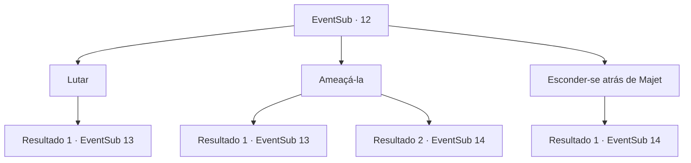

# Eventos secundários · 12

[Índice da tabela](index.md) · [Índice geral](../index.md)

ID: `pt:EventSub:12` · Fonte: `EventSub4` · Versão: 1.2.47.

Mapeamento estático dos arquivos; a disponibilidade e a execução dependem do estado da run.

## Texto do evento

*Sem texto no arquivo.*

## Dados de entrada

```json
{
  "id": 12,
  "grade": 1,
  "subEvent": "0",
  "required": ""
}
```

## Mapa das escolhas



## Escolhas e resultados

### Escolha 1

Lutar

Requisitos e outros campos da escolha:

```json
{
  "required": ""
}
```

#### Resultado 1.1

Você corre na frente de Majet e avança na aranha.

Continuação registrada: [Evento 13](0013.md) na mesma tabela.

```json
{
  "required": "",
  "chance": "1",
  "nextEvent": 13,
  "type": 2,
  "reward": "6_0_5",
  "place": 1
}
```

### Escolha 2

Ameaçá-la

Requisitos e outros campos da escolha:

```json
{
  "required": ""
}
```

#### Resultado 2.1

Você ameaça à aranha gigante. Ela recua por um instante, e então avança ainda mais irritada do que antes.

Continuação registrada: [Evento 13](0013.md) na mesma tabela.

```json
{
  "required": "",
  "chance": "9",
  "nextEvent": 13,
  "type": 1,
  "reward": "6_3_5",
  "place": 1
}
```

#### Resultado 2.2

Você ameaça a aranha. Oprimida por seu intenso carisma, ele rasteja de volta á sua toca. Vendo a aranha recuar, Majet fala. 

 "Isso foi realmente impressionante. Vamos em frente?"

 Após outra caminhada, você encontra uma grande caverna. |drawing_spiderCave| Você ouve alguém cantando dentro dela. 

 "Parece um homem... cantando em uma caverna? Nada suspeito."

 Majet tira o arco de seu ombro ao entrar. Você a segue palas profundezas da caverna. Dentro, há um homem cantando do conforto de sua cama. Ele se espanta ao ver vocês dois entrarem. 

 "Quem... Quem diabos são vocês?"


Continuação registrada: [Evento 14](0014.md) na mesma tabela.

```json
{
  "required": "",
  "chance": "1|0_12_1",
  "nextEvent": 14,
  "type": 0,
  "reward": "0_2_1"
}
```

### Escolha 3

Esconder-se atrás de Majet

Requisitos e outros campos da escolha:

```json
{
  "required": ""
}
```

#### Resultado 3.1

Depois de derrotar a aranha monstruosa, Majet olha para você com frieza. Então Majet fala, enquanto recupera uma flecha do seu cadáver. 

 "Não é à toa que é chamado de Bosque das Aranhas. Vamos, covarde."

  Depois de caminhar um pouco mais, você encontra uma grande caverna.|drawing_spiderCave|Você ouve alguém cantando lá dentro. 

 "Parece ser um homem... cantando em uma caverna? Nada suspeito."

 Majet tira o arco de seu ombro quando entra. Você a segue palas profundezas da caverna. Dentro, há um homem cantando confortavelmente em sua cama. Ele pula quando os vê entrando. 

 "Quem... quem diabos é você?"


Continuação registrada: [Evento 14](0014.md) na mesma tabela.

```json
{
  "required": "",
  "chance": "1",
  "nextEvent": 14,
  "type": 2,
  "reward": ""
}
```

## Referências que chegam a este evento

- [Evento 11 · escolha 1 · resultado 1](0011.md#escolha-1)
- [Evento 11 · escolha 2 · resultado 1](0011.md#escolha-2)
- [Evento 11 · escolha 2 · resultado 2](0011.md#escolha-2)
